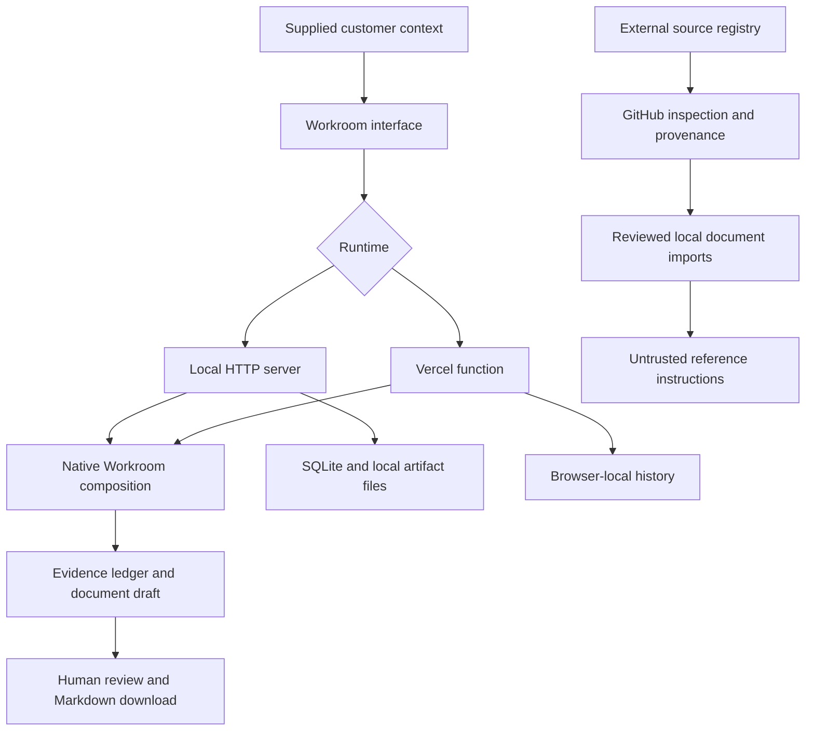

<div align="center">


# 🤘 POWER CHORDS

### Connected capabilities. One workspace. From customer evidence to product decisions.

**Turn customer context into clear plans, specifications, and documents ready for review.**

Built and led by **[Saurabh Misal](https://github.com/saurabhmisal)**.

[](package.json)
[](package.json)
[](docs/CAPABILITIES.md)
[](LICENSE)

[Get started](#get-started) · [Workflows](#native-workflows) · [Capabilities](#capabilities) · [Agent setup](#use-capabilities-with-your-agent) · [Hosting](#deploy-on-vercel) · [Security](#security-and-data-handling)

**For forward-deployed product managers, founding teams, technical product leaders, and builders who ship.**

</div>

---

## Contents

- [What Power Chords does](#what-power-chords-does)
- [Choose how to use it](#choose-how-to-use-it)
- [Landing page and platform setup](#landing-page-and-platform-setup)
- [Get started](#get-started)
- [Your first Workroom run](#your-first-workroom-run)
- [Native workflows](#native-workflows)
- [Writing useful inputs](#writing-useful-inputs)
- [Understanding the output](#understanding-the-output)
- [Capabilities](#capabilities)
- [Use capabilities with your agent](#use-capabilities-with-your-agent)
- [Explore third-party sources](#explore-third-party-sources)
- [Local and hosted behavior](#local-and-hosted-behavior)
- [Configuration](#configuration)
- [Storage, history, and backups](#storage-history-and-backups)
- [Architecture](#architecture)
- [Local HTTP API](#local-http-api)
- [Hosted HTTP API](#hosted-http-api)
- [Deploy on Vercel](#deploy-on-vercel)
- [Static catalog and GitHub Pages](#static-catalog-and-github-pages)
- [Source synchronization](#source-synchronization)
- [Command reference](#command-reference)
- [Development and validation](#development-and-validation)
- [Security and data handling](#security-and-data-handling)
- [Troubleshooting](#troubleshooting)
- [Extending Power Chords](#extending-power-chords)
- [Roadmap](#roadmap)
- [Frequently asked questions](#frequently-asked-questions)
- [Authorship, provenance, and licenses](#authorship-provenance-and-licenses)
- [Documentation index](#documentation-index)

## What Power Chords does

Power Chords combines a product Workroom, portable capability instruction packs, and a registry of external integration sources.

The Workroom turns supplied notes into structured Markdown documents. It organizes evidence, frames problems, outlines requirements, and prepares review checklists. The native engine uses deterministic composition templates: it does not need a model provider, API key, GPU, or external research service to generate these drafts.

The capability packs provide reusable instructions for compatible agents. They describe objectives, inputs, outputs, boundaries, and acceptance criteria. Their practical execution depends on the tools and permissions available in the host agent.

The external source registry supports discovery, inspection, and version-pinned document imports in the local runtime. Repository discovery does not install or execute repository code.

### What works today

| Area | Current behavior |
|---|---|
| Native document workflows | Generate discovery, integration, product decision, and launch documents from supplied context |
| Evidence ledger | Extract and reference user-supplied statements; flag conditional language |
| Markdown artifacts | Preview and download generated documents |
| Capability controls | Disable native capabilities and block dependent workflows |
| Local history | Store run metadata in SQLite and document files on disk |
| Hosted history | Store recent generated documents and preferences in the current browser |
| Portable instruction packs | Inspect and copy first-party capability instructions into agent skill folders |
| External source inspection | Read GitHub metadata, source trees, licenses, and document paths |
| Local instruction imports | Download supported, reviewed instruction/reference documents at an inspected commit |
| Intent matching | Suggest enabled local instruction packages using keyword matching; does not execute them |

### Execution boundaries

A capability name describes an area of work, not a promise of a running integration. For example, a release-readiness capability can help draft release gates; it does not automatically deploy an application. A financial-planning capability can structure assumptions; it does not connect to accounting software.

Native workflows do not browse the web, verify customer claims, run SQL against a production database, generate media, or act on external accounts. Those operations require an authorized host agent or an implemented adapter.

## Choose how to use it

| Path | Best for | Where work is stored | Setup |
|---|---|---|---|
| Local Workroom | Personal document drafting, persistent local history, source inspection and instruction imports | Local SQLite database and files | Clone repository, use Node.js, run the server |
| Hosted Workroom | Browser access to native drafting workflows | Recent documents in browser localStorage; temporary server processing | Deploy the included Vercel configuration |
| Agent instruction packs | Using capability guidance in your existing coding or work agent | Selected project skill directory | Run the capability installer |
| Static catalog | Browsing source metadata and update information | Generated static files | Build the catalog; optionally publish with GitHub Pages |

The static catalog and the interactive Workroom are different outputs. Serving the catalog does not provide the Workroom API.

## Landing page and platform setup

The dedicated landing page introduces the product, explains native workflows, and provides a searchable capability library with scope and discipline filters. Select a capability and choose Claude Code, Codex, Cursor, Gemini CLI, or another host to get the appropriate setup instructions.

- **Coding agents:** copy a project installation command and verify skill discovery in your host.
- **Other compatible agents:** install into a custom skill directory with `--dest`.
- **Chat-based platforms:** download the selected capability as Markdown, then attach or paste it where your platform supports manual instructions. Tool access and context limits still depend on that platform.
- **Native drafting:** run the local Workroom, or open `/workroom.html` on a complete hosted deployment.

Run `npm run build:site` to build the static landing page in `site/`. Run `node scripts/build-hosted.mjs` to build the Vercel landing page at `/` and hosted Workroom at `/workroom.html`. Portable capability downloads are included in both builds. See the [portable agent guide](docs/PORTABLE_AGENT_GUIDE.md) for platform boundaries and a reusable starter request.

## Get started

### Prerequisites

- **Node.js 24.x**, matching the engine declared in [package.json](package.json).
- npm, included with a standard Node.js installation.
- Git for cloning the repository, or an extracted copy of the release.
- A browser for the Workroom.

The native runtime uses Node's built-in SQLite module. There are no application dependencies to install for the basic local workflow.

Check your runtime:

```bash
node --version
npm --version
```

### Start from GitHub

```bash
git clone https://github.com/saurabhmisal/power-chords.git
cd power-chords
npm start
```

Open **[http://127.0.0.1:4327](http://127.0.0.1:4327)**.

Keep the server process running while you use the app. Stop it with **Ctrl+C**. The default server listens on the loopback interface of your own machine.

### Start from a downloaded release

1. Extract the release archive.
2. Open a terminal in the extracted `power-chords` directory.
3. Confirm your Node.js version.
4. Run `npm start`.
5. Open the local URL shown in the terminal.

### Try a command-line demonstration

```bash
npm run demo
```

The demo uses fictional customer notes, generates a reviewable document, and prints the artifact location. It does not contact an external model or research API.

## Your first Workroom run

1. **Choose an outcome.** Select the workflow that matches the document you need.
2. **Name the work.** Add a title that identifies the project or decision.
3. **State the objective.** Explain the outcome or decision you want the draft to support.
4. **Supply evidence.** Paste relevant notes, requirements, observations, constraints, and uncertainties.
5. **Generate.** The Workroom builds the draft and evidence ledger.
6. **Review.** Read the preview and check unsupported assumptions, ownership, dates, and metrics.
7. **Download.** Save the Markdown document for editing, sharing, or version control.

### Example input

**Workflow:** Customer Discovery → PRD

**Title:** Reduce partner onboarding friction

**Objective:** Prepare a reviewable proposal for simplifying partner integration setup.

**Context:**

```text
Partner operations currently copies order information between three systems.
Two recent discovery calls described repeated manual checks after failed imports.
Engineering is concerned that retries may create duplicate orders.
The operations team estimates that each exception takes 15 minutes to investigate,
but that estimate has not been measured.
A pilot must work with the existing partner API and keep an audit trail.
We have not agreed on a target onboarding time or a pilot owner.
```

This input gives the engine evidence and uncertainty to organize. The output should preserve the estimated nature of the investigation time and leave missing targets and ownership for review.

## Native workflows

### Customer Discovery → PRD

**Workflow ID:** `discovery-to-prd`

Use this when customer notes need to become a structured product proposal.

Useful inputs include discovery notes, user pain points, current workflows, business constraints, known requirements, and unanswered questions.

The draft includes problem framing, an evidence ledger, a journey hypothesis, requirement structure, experiment planning, and risks. It supports early alignment before committing to implementation.

**Review before use:** Customer segmentation, requirement priority, baseline metrics, acceptance criteria, and proposed experiments.

### Integration Readiness

**Workflow ID:** `integration-readiness`

Use this when a product depends on APIs, data exchange, or operational handoffs.

Useful inputs include system boundaries, API constraints, authentication concerns, data formats, retry behavior, failure cases, and rollout expectations.

The draft organizes contract questions, failure modes, test scenarios, dependencies, and release gates.

**Review before use:** Actual API specifications, security requirements, idempotency behavior, data ownership, and operational responsibility. The draft does not test or connect to the APIs.

### Product Decision Brief

**Workflow ID:** `product-decision`

Use this to prepare a decision that needs explicit options, assumptions, trade-offs, and evidence.

Useful inputs include the decision to make, alternatives, customer evidence, constraints, cost assumptions, and desired outcomes.

The draft provides a decision structure, comparison criteria, assumptions to validate, measurement considerations, and a decision record.

**Review before use:** Option completeness, financial assumptions, evidence quality, decision authority, and success measures.

### Launch Readiness Plan

**Workflow ID:** `launch-readiness`

Use this to organize the work required before and after a release.

Useful inputs include release scope, audience, dependencies, known risks, launch channels, deadlines, support concerns, and rollout constraints.

The draft structures launch workstreams, owner questions, quality gates, rollout stages, monitoring, and contingency planning.

**Review before use:** Actual owners, dates, release criteria, messaging, rollback procedures, and support readiness.

### Capability dependencies

Each workflow declares the capabilities it requires. Disabling a required native capability makes the dependent workflow unavailable.

The native controls apply to Workroom execution. Source-library group controls apply to imported packages; they are a separate control surface.

## Writing useful inputs

Good input is specific about what happened and honest about what remains unknown.

| Include | Example |
|---|---|
| Observations | “Three pilot users reported duplicate status notifications.” |
| Source context | “This comes from support notes collected during the pilot.” |
| Constraints | “The existing partner API cannot change this quarter.” |
| Desired decision | “Decide whether to improve retries or replace the integration.” |
| Uncertainty | “We estimate the delay at ten minutes; no instrumentation confirms it.” |
| Open questions | “Ownership of partner-side monitoring is unresolved.” |

Avoid mixing unverified estimates with measured facts. Include only information you are authorized to process.

### Input limits

| Field | Accepted input |
|---|---|
| Context | 30–20,000 characters; non-empty after trimming |
| Title | Optional; 1–160 characters when provided |
| Objective | Optional; 1–1,000 characters when provided |

The HTTP layers also bound request size. Large pasted payloads may hit that boundary before field validation. Uploading arbitrary files is not part of the native Workroom form; provide relevant text instead.

## Understanding the output

A generated artifact contains supplied context, evidence references, workflow-specific sections, and review gates.

### Evidence does not mean independent verification

Evidence references identify statements extracted from your input. They do not certify that the statements are true.

Conditional wording such as “estimate,” “might,” or “assuming” is labeled for review. This is a text heuristic, not a complete fact-checking system. A statement can still be incorrect even when it is classified as user-provided evidence.

### Drafts remain drafts

The native engine uses predefined structures and prompts. Some sections are templates or hypotheses to validate, rather than conclusions derived from a trained model.

Review the complete download, not only the preview. The browser preview is deliberately shortened for longer outputs.

### Local artifact integrity

Local runs receive an identifier and a SHA-256 hash. The artifact endpoint checks the stored hash when reading a document. This can detect changed content; it does not prove factual accuracy, authorship, or approval.

### Imported references

When enabled local instruction packages are available, the generated document can list them as pinned references. The Workroom does not interpret or execute those instructions as part of native generation.

## Capabilities

A capability is a named unit of product work with a stable identifier and documented execution scope.

Each first-party capability directory contains:

```text
capabilities/<functional-name>/
├── README.md
├── SKILL.md
├── capability.json
└── examples/
    └── example-request.md
```

| File | Purpose |
|---|---|
| `README.md` | Purpose, usage guidance, expected outputs, and boundaries |
| `SKILL.md` | Instructions for a compatible host agent |
| `capability.json` | Capability metadata |
| `examples/example-request.md` | A concrete request to adapt to your work |

### Capability families

| Family | Example areas |
|---|---|
| Research & Discovery | Customer problems, stakeholder context, opportunity mapping, market and competitor research |
| Document Intelligence | Document ingestion, OCR, extraction, knowledge graphs, retrieval |
| Product & Strategy | PRDs, journeys, roadmaps, prioritization, experiments |
| Engineering & Integration | API planning, system design, QA, release readiness |
| Design & Creation | Wireframes, prototypes, diagrams, technical illustrations |
| Agentic Automation | Task decomposition, orchestration, browser/API automation, permission controls |
| Data & Evaluation | SQL, reporting, operational diagnostics, evaluation, scenarios |
| Business & Operations | Invoicing, unit economics, operations design, resource planning |
| Voice & Media | Transcription, speech, audio editing, video |
| Marketing & Go-to-Market | Discoverability, launches, campaigns, growth experiments |
| Professional Enablement | Opportunity research, interviews, learning plans |
| Spatial & Field Intelligence | Maps, roads, geospatial visualization, field insights |

These families describe coverage. Refer to the implementation status before assuming a capability can perform a task.

### Implementation status

| Status | Meaning |
|---|---|
| `native_assistive` | Contributes planning, drafting, or analytical structure within implemented native workflows |
| `adapter_required` | Needs additional tools or a runtime adapter for practical execution |

A native-assistive capability is not a standalone implementation of every activity implied by its name. Read the individual guide and the workflow context.

**Start with the [usage guides](docs/CAPABILITY_GUIDES.md), [capability matrix](docs/CAPABILITIES.md), or [agent compatibility guide](docs/AGENT_COMPATIBILITY.md).**

## Use capabilities with your agent

### Browse and inspect

```bash
npm run capabilities:list
node scripts/capabilities-cli.mjs show 10
node scripts/capabilities-cli.mjs show prd-and-specification-writing
```

Identifiers are stable lookup keys, not a marketing count.

### Install one capability

From the Power Chords checkout:

```bash
node scripts/capabilities-cli.mjs install 10 --agent codex --project ../my-project
```

This creates a directory named `power-chords-prd-and-specification-writing` beneath the destination agent's skill folder.

### Select a destination

| Installer option | Project-relative destination |
|---|---|
| `--agent codex` | `.agents/skills/` |
| `--agent claude` | `.claude/skills/` |
| `--agent cursor` | `.cursor/skills/` |
| `--agent gemini` | `.gemini/skills/` |
| `--dest <directory>` | The directory you explicitly provide |

These are the installer's configured paths. Verify discovery in your host agent; a copied file does not guarantee automatic activation.

```bash
node scripts/capabilities-cli.mjs install 10 --agent claude --project ../my-project
node scripts/capabilities-cli.mjs install 10 --agent cursor --project ../my-project
node scripts/capabilities-cli.mjs install 10 --agent gemini --project ../my-project
node scripts/capabilities-cli.mjs install 10 --dest ../my-project/custom-skills
```

### Install the full instruction library

```bash
node scripts/capabilities-cli.mjs install --all --agent codex --project ../my-project
```

The installer copies first-party documentation and instructions. It does not install the external runtimes described by those instructions. Example requests remain available in the source repository; the installer excludes files beneath the examples directories.

### Updating an existing installation

The installer refuses an existing target directory by default. Review changes before using `--force`:

```bash
node scripts/capabilities-cli.mjs install 10 --agent codex --project ../my-project --force
```

The force option permits copying over existing files; it is not a clean uninstall or a guarantee that obsolete files are removed.

### Invoke a capability

Ask your agent:

> Use the Power Chords PRD and specification writing capability. Turn these authorized customer notes into a PRD with acceptance criteria. Identify missing evidence and keep estimates distinct from measured facts.

If discovery fails, point the agent to the installed `SKILL.md`. Actual tool use remains subject to the host agent's configuration, permissions, and capabilities.

## Explore third-party sources

The source library is separate from the first-party capability instruction library.

### Local source lifecycle

1. **Discover:** List a curated or synchronized GitHub source.
2. **Inspect:** Read metadata, source paths, license information, and an immutable commit.
3. **Review:** Check classification, blockers, dependencies, and provenance.
4. **Install documents:** Import supported instruction or reference files at the inspected revision.
5. **Enable:** Explicitly activate the installed package for the runtime user.
6. **Match intent:** Retrieve relevant enabled instructions as untrusted reference material.

### What installation means here

The local source installer accepts supported instruction/reference document packages. It does not clone and run an entire repository, install dependencies, start a service, or provision a model.

Imported documents are stored beneath `.local/installed/` by default. Installation and enablement are separate operations; installed source packages begin disabled.

### Review gates

- The source must be inspected before installation.
- The inspected revision must match the package's pinned revision.
- Incomplete inspections require manual review.
- Only supported document kinds are accepted.
- Licenses outside the implemented permissive allowlist require review.
- Required permissions must be granted before enablement.

The current allowlist recognizes MIT, Apache-2.0, CC0-1.0, BSD-2-Clause, BSD-3-Clause, and ISC. This is an implementation policy, not legal advice or a replacement for reading the actual license.

### Optional batch commands

```bash
POWER_CHORDS_INSPECT_LIMIT=3 npm run inspect:all
npm run install:reviewed
```

These commands use GitHub API access and may encounter rate limits or missing repository permissions. Run the installation command only after reviewing the inspected candidates.

### Intent matching

The local intent router matches keywords against installed and enabled instruction packages. Results include source attribution and pinned revisions.

A match is a preview for a host application. It does not invoke a model, launch an adapter, or perform external actions.

## Local and hosted behavior

| Feature | Local Workroom | Hosted Workroom |
|---|---|---|
| Native generation | Runs on your machine | Runs in a server function |
| Work history | SQLite metadata plus Markdown files | Recent documents in this browser |
| Persistence | Survives server restart when files are retained | Survives page reload when browser storage is retained |
| Cross-device history | No built-in sync | No built-in sync |
| Native capability preferences | Local database | Browser storage |
| Source inspection | GitHub API | GitHub API |
| Source document installation | Supported after review | Requires local runtime |
| Intent router | Local keyword-matching preview | Hidden in hosted UI |
| Customer-context processing | Local native generation | Sent to the deployment server |
| Accounts | Runtime user identifier; no web login system | No application login or shared account system |
| Server storage | Persistent local paths | Request-scoped memory and temporary files |

The hosted UI keeps the most recent **30 documents**. This is a retention limit, not a capability count. Download work you need to retain independently.

## Configuration

The local server reads environment variables directly. It does not include automatic `.env` loading.

| Variable | Default | Purpose |
|---|---|---|
| `POWER_CHORDS_PORT` | `4327` | Local HTTP port |
| `POWER_CHORDS_USER_ID` | `local` | Runtime user key for settings, history, and audit |
| `POWER_CHORDS_DB` | `.local/powers.sqlite` beneath the repository | Local SQLite file |
| `POWER_CHORDS_STORAGE` | `.local/` beneath the repository | Workroom and installed-document storage root |
| `POWER_CHORDS_INSPECT_LIMIT` | All available sources | Maximum candidates for the batch inspection command |
| `GITHUB_TOKEN` | Unset | Optional authenticated GitHub API access |
| `GH_TOKEN` | Unset | Fallback token for the upstream synchronization client |

The runtime GitHub client reads `GITHUB_TOKEN`; the upstream synchronization client also supports `GH_TOKEN`. The batch inspection/import utilities use their own default storage setup; check their source before assuming every server option applies to every command.

### Use another port

```bash
POWER_CHORDS_PORT=4330 npm start
```

Open the matching port in your browser.

### Use a separate local workspace

```bash
POWER_CHORDS_USER_ID=personal \
POWER_CHORDS_DB=/absolute/path/to/workspace/powers.sqlite \
POWER_CHORDS_STORAGE=/absolute/path/to/workspace \
npm start
```

Changing the runtime user key is not authentication. Separate database and storage paths are appropriate when you need independent local workspaces.

### GitHub credentials

Native drafting and first-party instruction installation need no GitHub token. Source inspection and synchronization may benefit from authenticated API access.

Provide credentials through your environment or a suitable secret manager. Do not commit credentials, paste them into customer context, or include them in fixtures.

## Storage, history, and backups

### Default local layout

```text
.local/
├── powers.sqlite
├── powers.sqlite-wal       # may exist while SQLite is active
├── powers.sqlite-shm       # may exist while SQLite is active
├── installed/
│   └── <source>/<revision>/<document>/
└── workroom/
    └── <runtime-user>/
        └── <run-id>.md
```

SQLite stores source/package state, preferences, audit entries, and run metadata. Markdown files store generated documents.

### Back up local work

1. Stop the server.
2. Copy the complete database and storage directories to your backup destination.
3. Keep database metadata and document files together.
4. Restart the server and confirm recent documents are accessible.

If you configured separate paths, back up both. Copying only the SQLite database does not copy the Markdown artifacts it references.

### Hosted browser storage

Hosted documents and preferences use localStorage for the deployment's origin. They do not automatically follow you to another browser, device, or domain.

Clearing site data, using temporary browsing sessions, or storage restrictions can remove or prevent saved history. If saving fails because storage is full, the UI prompts you to download the generated document.

## Architecture



### Main components

| Component | Responsibility |
|---|---|
| `src/server.mjs` | Local HTTP routing, session cookie, host/origin checks, static assets |
| `src/workroom.mjs` | Native workflow definitions, capability controls, generation, artifact integrity |
| `src/db.mjs` | SQLite schema, source/package records, settings, audit |
| `src/engine.mjs` | Source inspection/import lifecycle and intent matching |
| `src/github.mjs` | Restricted GitHub API client, license and path helpers |
| `src/catalog.mjs` | Curated external-source metadata and source groups |
| `public/app.js` | Workroom and source-library browser interactions |
| `public/hosted.js` | Hosted browser preferences, history, and artifact download URLs |
| `api/hosted.js` | Request-isolated hosted API |
| `data/capability-guides.json` | First-party capability documentation metadata |

### Repository layout

```text
power-chords/
├── README.md
├── LICENSE
├── THIRD_PARTY_NOTICES.md
├── CONTRIBUTING.md
├── package.json
├── vercel.json
├── api/                 # Hosted function
├── assets/              # README and project artwork
├── capabilities/        # Portable first-party instruction packs
├── data/                # Capability metadata and source update snapshots
├── docs/                # Architecture, guides, compatibility, deployment
├── examples/            # Sample customer context
├── public/              # Interactive Workroom frontend
├── scripts/             # Installers, validators, builders, source sync
├── site/                # Generated static catalog
├── src/                 # Local runtime and composition engine
└── test/                # Node test suite
```

## Local HTTP API

The API is intended for the local Workroom. Open the app first to establish its session cookie.

Local API requests require the current session cookie. Write requests also require a matching local Origin header. Source and package identifiers embedded in paths must be URL-encoded.

| Method | Endpoint | Purpose |
|---|---|---|
| GET | `/api/state` | Sources, groups, packages, summary |
| GET | `/api/workroom` | Native capabilities, workflows, recent runs |
| POST | `/api/workroom/run` | Generate a document |
| GET | `/api/workroom/artifacts/:id` | Download and integrity-check a local document |
| POST | `/api/workroom/powers/:id/toggle` | Enable/disable a native capability |
| GET | `/api/activity` | Runtime audit entries |
| POST | `/api/groups/:id/toggle` | Enable/disable an external source group |
| POST | `/api/sources/:id/inspect` | Inspect a GitHub source |
| POST | `/api/packages/:id/install` | Import a supported reviewed document package |
| POST | `/api/packages/:id/toggle` | Enable/disable an imported package |
| POST | `/api/route` | Preview matching enabled instruction packages |
| POST | `/api/sync` | Discover recent forks for the supported owner |

### Generate a document programmatically

With the local server running:

```bash
curl --cookie-jar /tmp/power-chords.cookies \
  http://127.0.0.1:4327/ --output /dev/null

curl --cookie /tmp/power-chords.cookies \
  --header 'Origin: http://127.0.0.1:4327' \
  --header 'Content-Type: application/json' \
  --data '{
    "workflowId": "integration-readiness",
    "title": "Partner order integration",
    "objective": "Prepare a reviewable integration plan.",
    "context": "Partner orders arrive from three systems. Retries may duplicate orders. We need an audit trail and a pilot rollback plan."
  }' \
  http://127.0.0.1:4327/api/workroom/run
```

Use the response's `download` path to retrieve the document with the same session cookie. Local generation returns HTTP 201 on success.

### Generation response fields

| Field | Meaning |
|---|---|
| `id` | Generated run identifier |
| `title` | Document title |
| `workflowId` | Selected workflow |
| `sha256` | Hash of generated Markdown |
| `evidenceCount` | Number of extracted evidence entries |
| `capabilities` | Workflow capability identifiers |
| `content` | Complete Markdown document |
| `download` | Local artifact endpoint |
| `executed` | Native composition completed |
| `external_actions` | False for native generation |

## Hosted HTTP API

The hosted frontend calls `/api/hosted`.

| Request | Behavior |
|---|---|
| GET | Return catalog state and native capability/workflow definitions |
| POST with `action: "run"` | Generate a document from `input`, honoring supplied `disabled` capability IDs |
| POST with `action: "inspect"` | Inspect the supplied `sourceId` through GitHub |

POST requests must use the deployment's HTTPS origin. Each request creates a separate in-memory database and temporary directory, then closes and removes them.

The browser stores returned document content and builds a local Blob download URL. The local server's artifact endpoints are not hosted history endpoints. Direct API callers should save the returned `content` themselves.

This API has no application-level account authentication or rate-limiting layer. Origin checks are a browser request constraint, not an identity system.

## Deploy on Vercel

The repository includes a hosted build and Node.js function configuration. Native hosted drafting does not need a model API key or a provisioned database.

### Project settings

| Setting | Value |
|---|---|
| Framework preset | Other; configuration specifies `framework: null` |
| Node.js | 24.x |
| Build command | `node scripts/build-hosted.mjs` |
| Output directory | `dist` |
| Function entry point | `api/hosted.js` |

### Deploy from GitHub

1. Push this repository to your GitHub account.
2. Sign into Vercel and create a project.
3. Import the repository, granting the required repository access if prompted.
4. Confirm that Vercel reads the checked-in configuration.
5. Deploy and wait for a successful build.
6. Open the production URL and generate a sample document.
7. Download the result and reload the page to check browser-local history.

### Deploy through the official CLI

From the repository root, with the Vercel CLI installed:

```bash
vercel login
vercel --prod
```

Choose the intended account/team and project during setup. Complete any authorization in your browser. A generated build directory alone does not create a public deployment.

### Verify the deployment

- The page loads the native workflow choices and catalog.
- A valid sample input produces a preview.
- The Markdown download contains the complete output.
- Refreshing the same browser origin retains recent saved work.
- Disabling a required capability blocks its workflow.
- Another browser session does not inherit your saved history.

See [Vercel deployment details](docs/VERCEL.md). This README does not advertise a live deployment until a public URL is available and verified.

## Static catalog and GitHub Pages

```bash
npm run build:site
```

The static builder produces the dedicated landing page at `site/index.html`, with its searchable capability library, platform setup selector, portable downloads, documentation links, and assets. It does not host Node.js APIs or the interactive Workroom's execution engine.

The repository includes a GitHub Actions Pages job. Publishing depends on the repository's Pages configuration, permissions, and successful workflow completion.

The public landing page uses Google Analytics 4 in the existing **Lazo Website** property (measurement ID `G-B3WTD82CQ0`). Tracking loads only on `https://powerchords.lazo.tools`; local Workrooms, preview deployments, and forks do not send analytics. The tag is configured in `landing/analytics.js` and copied into the static build. In GA4, use the **Hostname** dimension to distinguish Power Chords traffic from `lazo.tools`.

## Source synchronization

Power Chords tracks fork revisions and original upstream metadata separately.

```bash
npm run sync:upstreams
npm run render:updates
npm run build:site
```

| File | Purpose |
|---|---|
| `data/upstreams.lock.json` | Source revision snapshot |
| `data/updates.json` | Detected source changes |
| `docs/SOURCE_UPDATES.md` | Rendered update summary |
| `site/index.html` | Rebuilt catalog |

### Synchronization behavior

Synchronization reads GitHub metadata. It does not pull and execute upstream repositories, install dependencies, or automatically enable new instructions.

The source workflow supports a scheduled check at minute 17 of each hour, manual dispatch, a repository-dispatch event, and selected pushes. Scheduled execution depends on GitHub Actions availability and repository settings; it is not an instantaneous update guarantee.

The workflow can commit verified metadata changes and publish the static catalog. An upstream change does not imply that a new version has been reviewed for execution.

## Command reference

Run these commands from the repository root.

| Command | Purpose | Network / mutation |
|---|---|---|
| `npm start` | Start local Workroom | Creates/updates local runtime storage |
| `npm run demo` | Generate a sample document | Writes local demo artifacts |
| `npm test` | Run Node tests | Uses local fixtures and a local HTTP server |
| `npm run validate:catalog` | Validate source metadata and update schema | Local validation |
| `npm run validate:capabilities` | Validate capability packages and alignment | Local validation |
| `npm run capabilities:list` | List capability identifiers and status | Read-only |
| `node scripts/capabilities-cli.mjs show 10` | Inspect one capability | Read-only |
| `npm run capabilities:install -- 10 --agent codex --project ../my-project` | Copy an instruction pack | Writes to selected destination |
| `npm run capabilities:docs` | Regenerate capability documentation | Rewrites generated capability files |
| `npm run inspect:all` | Inspect external source candidates | GitHub reads and local metadata writes |
| `npm run install:reviewed` | Import supported inspected documents | GitHub reads and local file writes |
| `npm run sync:upstreams` | Refresh source revision snapshot | GitHub reads and tracked metadata writes |
| `npm run render:updates` | Generate update documentation | Writes generated documentation |
| `npm run build:site` | Build static catalog | Writes `site/` |
| `node scripts/build-hosted.mjs` | Build hosted frontend | Writes ignored `dist/` |
| `npm run keepalive` | Update repository activity metadata | Writes activity marker |

The package also defines `npm run smoke`, but its referenced `src/smoke.mjs` entry point is absent in this checkout. Use the test suite and demo for verification.

## Development and validation

### Check the runtime and package metadata

```bash
node --version
npm run validate:catalog
npm run validate:capabilities
npm test
```

### Check generated outputs

```bash
npm run build:site
node scripts/build-hosted.mjs
git diff --check
```

Review generated changes before committing. Regenerating capability documentation should begin with changes to `data/capability-guides.json`, followed by `npm run capabilities:docs`.

### Test coverage areas

The suite checks capability metadata, installer behavior, source classification, license gates, pinned imports, permission and group revocation, source synchronization, intent boundaries, native workflow composition, local HTTP sessions/origins, artifact integrity, and hosted request isolation.

Tests verify behavior within their fixtures. They do not certify third-party services, establish production hardening, or prove that every documented integration is operational.

### Continuous integration

The checks workflow runs validators, tests, a static-site build, and a reproducibility check. The checked-in GitHub workflows currently select Node.js 22, while `package.json` specifies Node.js 24.x for the application. Treat these as separate configurations when diagnosing local-versus-CI differences.

## Security and data handling

### Local protections

- Loopback-only listening and explicit host checks.
- A random per-process session secret in an HttpOnly, SameSite=Strict cookie.
- Origin checks for write requests.
- Bounded request bodies and field validation.
- Per-runtime-user settings and artifact lookup.
- SHA-256 checks for local document retrieval.
- Version-pinned imported documents and license gates.
- No arbitrary repository code execution in the implemented document importer.

The session cookie controls access to the local API from the browser. It is not a multi-user login system. Restarting the process rotates the session secret; refresh the app to establish a new session.

### Hosted processing

Customer context is sent to the deployed server for composition. Each request uses isolated temporary storage that is cleaned up after processing. The application does not intentionally retain context in a shared server database or write it to application logs.

This does not make a claim about every hosting-platform log, infrastructure process, or retention policy. Use the hosting provider's controls for your deployment's requirements.

Documents and preferences are saved in the browser without application-level encryption. Other people with access to that browser profile may be able to access them.

### Boundaries to understand

- Local files and SQLite are not encrypted by Power Chords.
- Runtime user IDs are configuration values, not authenticated identities.
- The hosted application has no team authorization model or shared durable workspace.
- Native drafts require human validation.
- Imported instructions remain untrusted material.
- A production sandbox for arbitrary third-party executables is not implemented.
- Specialized tools may have their own credentials, licenses, resource costs, and execution requirements.
- Public hosting needs appropriate operational controls for your intended audience and workload.

## Troubleshooting

| Symptom | Likely cause | What to check |
|---|---|---|
| SQLite import fails | Wrong or incompatible Node runtime | Use Node.js 24.x and verify `node --version` |
| Server exits with address-in-use error | Another process occupies the port | Stop the other process or set `POWER_CHORDS_PORT` |
| “Session required” | Missing or expired local cookie | Reload the local app; API clients must retain the current cookie |
| “Invalid host” | Access through an unsupported hostname or proxy | Use the loopback URL and configured port |
| “Invalid request origin” | Wrong scheme, host, or port | Use the exact app origin; do not relax the check to work around a proxy |
| Context validation fails | Input too short, too long, or blank | Supply 30–20,000 characters of relevant text |
| Required native power is disabled | A workflow dependency was revoked | Re-enable the required capability in advanced controls |
| GitHub returns 403 | Rate limit or repository permissions | Check authenticated access and API rate limits |
| Source cannot be installed | Unsupported package kind, license, incomplete inspection, or revision mismatch | Review blockers and inspect the current source revision |
| Installed skill does not appear in an agent | Agent uses another skill path or discovery behavior | Verify the installed directory or reference `SKILL.md` directly |
| “Already installed” | Destination exists | Review local changes before choosing `--force` |
| Hosted history is missing | Different origin/profile or cleared site storage | Return to the original browser origin; restore downloaded documents separately |
| Hosted storage warning | Browser quota or policy prevents saving | Download the current document immediately |
| Static site opens but generation is unavailable | Catalog deployed instead of Workroom | Deploy the hosted frontend and API using `vercel.json` |
| Vercel cannot import the repository | GitHub app access is missing | Authorize the intended repository or use an authenticated CLI deployment |
| Local artifact is missing | Database and files were separated or deleted | Restore the matching database and storage backup |
| Artifact integrity check fails | Stored document changed after generation | Preserve the changed file separately and investigate; avoid treating it as the original artifact |

## Extending Power Chords

### Improve a documented capability

1. Edit the source metadata in `data/capability-guides.json`.
2. Run `npm run capabilities:docs`.
3. Review generated guides, manifests, examples, and instructions.
4. Run `npm run validate:capabilities` and `npm test`.
5. State whether the change improves instructions or adds executable behavior.

### Add a native workflow

Study `src/workroom.mjs` and the existing workflow tests. A contribution should define inputs, required capabilities, evidence treatment, output structure, validation limits, and failure behavior.

Add positive and negative tests, including behavior when a required capability is disabled. Update the documentation to reflect the actual execution scope.

### Add an external adapter

The [adapter SDK](docs/ADAPTER_SDK.md) describes a proposed contract, not an implemented general-purpose sandbox.

A useful adapter contribution should identify its source and license, credentials, dependencies, permission requirements, validation, resource limits, timeout behavior, outputs, audit events, and cleanup/rollback strategy.

Do not mark a capability executable merely because its source repository appears in the catalog.

### Contribution checklist

- Describe the user outcome and supported capability identifiers.
- Include a working fixture and appropriate integration tests.
- Explain required permissions and external side effects.
- Preserve upstream attribution and license obligations.
- Keep secrets and private customer material out of examples.
- Update relevant guides and compatibility status.
- Run validators and tests before submitting.

See [CONTRIBUTING.md](CONTRIBUTING.md).

## Roadmap

| Area | Current position | Direction |
|---|---|---|
| Native Workroom | Implemented document workflows and reviewable artifacts | More operators and richer workflow composition |
| Portable capability packs | Documented instructions, metadata, examples, installer | Better host-agent integration and acceptance fixtures |
| Source registry | Inspection and pinned document imports | Stronger compatibility and provenance review |
| Hosted mode | Request-isolated generation and browser-local history | Durable accounts/history only with an explicit storage and authorization design |
| External execution | Proposed adapter contract | Reviewed adapters with bounded, auditable execution |
| Production hardening | Prototype protections and explicit boundaries | Operational controls, secret handling, isolation, and release assurance |

Roadmap entries describe intended work, not released functionality.

## Frequently asked questions

### Is this an LLM application?

The native Workroom is a deterministic drafting engine. Portable instruction packs can be used by an LLM-based host agent, but the native app does not require one.

### Do I need an API key?

Not for native generation or installing first-party instruction packs. GitHub inspection may use a token, and future/external adapters may need their own credentials.

### Can I use one capability without running the app?

Yes. Install its instruction pack into a supported destination or read its guide directly. The host agent supplies execution tools.

### Does installing a capability make every feature runnable?

No. Installation copies instructions and metadata. Specialized execution still needs the relevant tools or adapters.

### Is the hosted Workroom the same as the full local runtime?

They share native generation, but their storage and source-management behavior differ. The local runtime supports persistent SQLite history and reviewed document imports; hosted history belongs to the current browser.

### Can I use the hosted app across devices?

You can open a deployed URL from other devices, but saved work does not automatically synchronize. Download documents to move them between environments.

### Can I use this with confidential customer information?

Decide based on your environment, permissions, and data-handling requirements. Local generation stays on your machine; hosted generation sends context to the deployment server. Neither mode adds encryption at rest or a production team-access system by itself.

### Does GitHub Pages host the full Workroom?

No. The included Pages path publishes the static catalog. The Workroom needs its local server or the hosted API deployment.

### Why do some capability names sound broader than their native behavior?

The capability map covers product work across disciplines. Status metadata and usage guides narrow each capability's current support. Native assistance often means structuring a draft, plan, or review checklist.

### Where should I report a problem?

Use this repository's issue tracker. Include reproduction steps, runtime version, expected behavior, actual behavior, and a sanitized error. Exclude tokens, customer secrets, and private source material.

## Authorship, provenance, and licenses

**Power Chords is created and led by [Saurabh Misal](https://github.com/saurabhmisal).** Its first-party Workroom, workflow composition, capability documentation, UI, persistence, and execution controls are maintained as this project.

First-party repository files use the [MIT license](LICENSE). Preserve the applicable copyright and license notices when reusing or distributing them.

External projects remain the work of their respective authors. Their licenses and obligations are independent of Power Chords. Referencing a source, inspecting it, or importing an instruction document does not transfer authorship or automatically establish compatibility for every form of reuse.

See [THIRD_PARTY_NOTICES.md](THIRD_PARTY_NOTICES.md) and the original source licenses before redistribution or integration.

## Documentation index

| Document | What to read it for |
|---|---|
| [Capability usage guides](docs/CAPABILITY_GUIDES.md) | Individual capability instructions and entry points |
| [Capability matrix](docs/CAPABILITIES.md) | Scope and implementation status |
| [Agent compatibility](docs/AGENT_COMPATIBILITY.md) | Installer destinations and execution boundaries |
| [Architecture](docs/ARCHITECTURE.md) | Runtime organization and contracts |
| [Adapter SDK](docs/ADAPTER_SDK.md) | Proposed external runtime lifecycle |
| [Vercel deployment](docs/VERCEL.md) | Hosted setup and persistence limits |
| [Project overview](docs/PROJECT.md) | Project framing |
| [Source inventory](docs/SOURCES.md) | External integration source context |
| [Source updates](docs/SOURCE_UPDATES.md) | Generated source revision changes |
| [README benchmark](docs/README_BENCHMARK.md) | Earlier documentation/reference research |
| [Examples](examples/README.md) | Sample customer discovery material |
| [Contributing](CONTRIBUTING.md) | Contribution expectations |
| [Third-party notices](THIRD_PARTY_NOTICES.md) | Attribution and provenance |
| [License](LICENSE) | First-party license terms |

---

<div align="center">

### Think like a PM. Build like an engineer. Deliver like a rockstar.

**[Get started](#get-started) · [Explore capabilities](docs/CAPABILITIES.md) · [Read the architecture](docs/ARCHITECTURE.md)**

**Power Chords · Created and led by [Saurabh Misal](https://github.com/saurabhmisal)**

</div>
