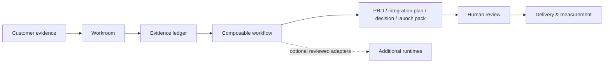

<div align="center">


# 🤘 POWER CHORDS

### Connected capabilities. One workspace. From customer evidence to product decisions.

**Turn customer context into clear plans, specifications, and documents ready for review.**

**Built by [Saurabh Misal](https://github.com/saurabhmisal)** · Original Power Chords Workroom & orchestration architecture

[](#get-started)
[](#test-it)
[](docs/CAPABILITIES.md)
[](#security--control)

[⚡ **Get started**](#get-started) · [🧠 **The Workroom**](#workroom) · [🎯 **Real examples**](#four-working-workflows) · [🏗️ **Architecture**](docs/ARCHITECTURE.md) · [🧩 **Extend it**](docs/ADAPTER_SDK.md)

**For Forward-Deployed PMs, founding teams, technical product leaders, and builders who ship.**

</div>

---

## Why Power Chords?

A power chord is powerful because a few notes work together. Product delivery works the same way: strong discovery without engineering doesn't ship; good code without customer evidence doesn't solve the right problem; a launch without feedback doesn't prove impact.

Power Chords is an original **local-first product Workroom** with a shared execution system, composable workflow contracts, per-user capability controls, evidence-backed drafts and downloadable artifacts.

It's designed to turn messy, incomplete inputs into something useful **today**, while providing a consistent architecture for richer AI and application integrations **tomorrow**.

Run native workflows, generate deliverables, inspect an audit trail, and retrieve previous work. The capability map distinguishes working drafting tools from capabilities that need additional integrations.

### From the field to the product



## Portable capabilities for your agent and workflow

**Each capability includes a usage guide, an Agent Skill instruction file, a manifest, and an example request.** The packages are independent of any model provider and can be used individually or alongside the local Workroom.

**[Browse every capability and its usage guide →](docs/CAPABILITY_GUIDES.md)**

```bash
# Browse available capabilities
npm run capabilities:list

# Install capability #10 as a local Codex Agent Skill in your project
node scripts/capabilities-cli.mjs install 10 --agent codex --project .

# Install the same power into Claude Code, Cursor or Gemini CLI
node scripts/capabilities-cli.mjs install 10 --agent claude --project .
node scripts/capabilities-cli.mjs install 10 --agent cursor --project .
node scripts/capabilities-cli.mjs install 10 --agent gemini --project .

# Use a custom skill folder for another compatible AI agent
node scripts/capabilities-cli.mjs install 10 --dest ./my-agent/skills
```

After installation, open your agent and ask: **“Use the Power Chords PRD and specification writing skill to turn these notes into a reviewable PRD with acceptance criteria.”** If your agent doesn't discover project-local skills automatically, reference the generated `SKILL.md` directly.

The installer copies first-party instructions and metadata only; it does not run third-party code, install models, grant permissions, or enable unsupported tools. The guides explain which capabilities support native Workroom drafting workflows and which require additional runtime adapters. A documented capability does not imply an operational integration.

For individual instructions, schemas, examples, and acceptance criteria, open any `capabilities/<functional-name>/README.md`. See [Agent compatibility and boundaries](docs/AGENT_COMPATIBILITY.md).

## Get started

**Requirements:** Node.js 22.13+ (including Node's built-in SQLite); no hosted account, API key, GPU, or paid model required for the native Workroom.

```bash
git clone https://github.com/saurabhmisal/power-chords.git
cd power-chords
npm start
```

Open **http://127.0.0.1:4327**. You'll land in the Workroom—not a repository directory. Pick an outcome, paste real context, and generate a work product.

> **Using the downloadable release?** Extract the project and run `npm start` in its `power-chords` folder. The repository URL above only works after this release is actually published to GitHub.

### See a complete local run

```bash
npm run demo
```

The demo creates an evidence-grounded PRD from fictional customer notes, writes a versioned Markdown artifact to `.local/`, and prints its location. No external API is called.

### Test it

```bash
npm test
npm run validate:catalog
```

## Workroom

The Workroom has one primary interaction model: **select the outcome and supply real evidence**. It then executes a known, auditable composition of capabilities and produces a document for human review.

| Component | What it does in v0.2 |
|---|---|
| ⚡ **Native Workflows** | Executes four evidence-backed document workflows without an LLM or network |
| 📋 **Evidence Ledger** | Records user-supplied observations and labels conditional claims |
| 🧩 **Power Composition** | Associates each workflow with a set of named, permission-aware capabilities |
| 📝 **Artifact Generator** | Produces structured Markdown with checklists, assumptions and review gates |
| 🔐 **User Controls** | Lets a user disable native powers; dependent workflows immediately stop |
| 💾 **Local History** | Persists runs in a local SQLite database with SHA-256 integrity checks |
| 🛡️ **Safe Extension Registry** | Tracks additional integration sources without executing unreviewed packages |

### Four working workflows

| Workflow | Input | Downloadable output |
|---|---|---|
| **01 · Customer Discovery → PRD** | Notes, requirements, pain points | Problem framing, evidence ledger, journey, requirements, measurement plan |
| **02 · Integration Readiness** | System constraints, APIs, integration issues | Contract questions, failure analysis, test matrix, release gates |
| **03 · Product Decision Brief** | Context, alternatives, desired business outcome | Decision scorecard, trade-offs, baselines to validate, decision record |
| **04 · Launch Readiness Plan** | Launch context and concerns | Workstream owners, rollout stages, launch criteria, monitoring plan |

Each workflow is **implemented and test-covered**. These are evidence-grounded structured drafts, not autonomous web research, actual software builds, external API calls, or verified business decisions.

### What an output looks like

```text
CUSTOMER NOTES
    │
    ├─ E01: Manual reconciliation across partner APIs
    ├─ E02: Reported delays, pending validation
    └─ E03: Engineering concern about retry duplication
    │
    ▼
INTEGRATION READINESS PACK
    ├─ Confirmed source context
    ├─ Identity / API / payload questions
    ├─ Idempotency and timeout test matrix
    ├─ Release and rollback gates
    └─ Owner sign-off checklist
    │
    ▼
DOWNLOAD .MD  +  LOCAL AUDIT  +  REVIEW REQUIRED
```

## A shared architecture for connected capabilities

Power Chords has a single local runtime and contracts for the distinct kinds of capabilities it can host.

```text
                        POWER CHORDS
                        Local Workroom
                              │
                   ┌──────────┴──────────┐
                   │  User Intent / Goal │
                   └──────────┬──────────┘
                              │
                      Workflow Registry
                              │
                ┌─────────────┴──────────────┐
                │                            │
           Native Execution             Adapter Boundary
           (WORKING NOW)              (FUTURE / REVIEWED)
                │                            │
          ┌─────┼──────┐             ┌───────┼─────────┐
          │     │      │             │       │         │
       Evidence  Docs  QA         Agent     APIs     Runtime
          │     │      │             │       │         │
          └─────┴──────┴─────────────┴───────┴─────────┘
                              │
                    Permission + Audit
                              │
                 Local Artifacts & History
```

- **Power contract:** Each capability has a stable identifier, family and maturity status.
- **Workflow contract:** A named objective declares its capability requirements and execution stages.
- **Local output:** Generated artifacts are stored in a per-user local workspace and can be downloaded.
- **Permission boundary:** Disabling a required native capability prevents its workflow from executing. Third-party source packages require review before activation.
- **Honest interoperability:** GPU services, desktop apps, browser automations and remote providers need real adapters and their own safe execution environments.

See [architecture](docs/ARCHITECTURE.md), [adapter design](docs/ADAPTER_SDK.md) and [status matrix](docs/CAPABILITIES.md).

## Capabilities across product disciplines

Power Chords organizes a forward-deployed builder's operating system around **twelve power families**: discovery, document intelligence, product strategy, engineering, design, agents, analytics, operations, voice/media, growth, professional enablement and spatial intelligence.

The [capability matrix](docs/CAPABILITIES.md) identifies capabilities supported by native drafting workflows and those requiring reviewed adapters, making their current execution scope clear.

### Architecture decisions that make the difference

**One workflow, multiple powers.** A Workroom run references a group of capability IDs and produces one coherent deliverable rather than opening separate applications.

**Real evidence, clear uncertainty.** Work products label assumptions and leave metrics, approvals and owners unverified until supported.

**Local by default.** Native execution does not send customer inputs to a model provider or third-party service. Local data still needs appropriate device and filesystem protection.

**Model and provider neutral.** Additional integrations are optional; the core system remains useful without choosing an AI model.

**Open but permissioned.** Discovering a package does not install, execute or grant access to it. Updates do not automatically enable new permissions.

## Security & control

The local HTTP service binds to `127.0.0.1`, uses a session cookie, validates request origins for writes, and does not expose arbitrary file paths. Generated artifacts are access-scoped and validated by hash; request bodies are bounded, and the native workflow does not execute shell commands or third-party scripts.

**Known limitations:** This is an early local prototype, not a multi-tenant hosted service. The local SQLite database and Markdown files are **not encrypted at rest**, runtime sandboxing for third-party executables isn't implemented, and the included library's broader adapters are not yet production-ready. Do not run it on a shared or untrusted host with sensitive customer information.

## Engineering roadmap

| Phase | Outcome | Status |
|---|---|---|
| I | Cohesive Workroom with real artifact generation | ✅ Implemented |
| II | Native power registry, per-user revocation and audit | ✅ Implemented |
| III | Capability packages with usage guides, manifests, and examples | ✅ Documented and packaged; runtime scope varies |
| IV | Source package inspection and pinned instruction imports | ✅ Prototype; no arbitrary code execution |
| V | More native operators and evidence-aware data connectors | ⏳ Planned |
| VI | Production-reviewed adapters for external applications/services | ⏳ Planned |
| VII | Isolated execution, hardened secrets, signed releases | ⏳ Planned |

Contributions are welcome; see [CONTRIBUTING.md](CONTRIBUTING.md).

## Authorship, provenance & licenses

**Power Chords is built and led by [Saurabh Misal](https://github.com/saurabhmisal)** with its own Workroom implementation, workflow contracts, UX, local persistence, execution rules and artifact generation. The original Power Chords files in this repository use the [MIT license](LICENSE).

Power Chords is designed to interoperate with independent open-source projects. Those projects remain the work of their respective authors and may carry separate license obligations. See [THIRD_PARTY_NOTICES.md](THIRD_PARTY_NOTICES.md) for source provenance and compatibility status. This project does **not** represent their implementations as newly authored Power Chords code.

---

<div align="center">

### 🤘 Think like a PM. Build like an engineer. Deliver like a rockstar.

**[Get started](#get-started) · [Explore capabilities](docs/CAPABILITIES.md) · [See architecture](docs/ARCHITECTURE.md)**

**Power Chords · Created and led by [Saurabh Misal](https://github.com/saurabhmisal)**

</div>
