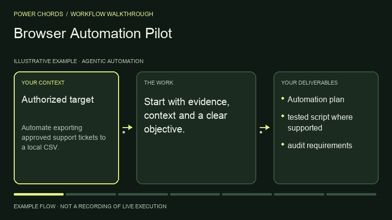
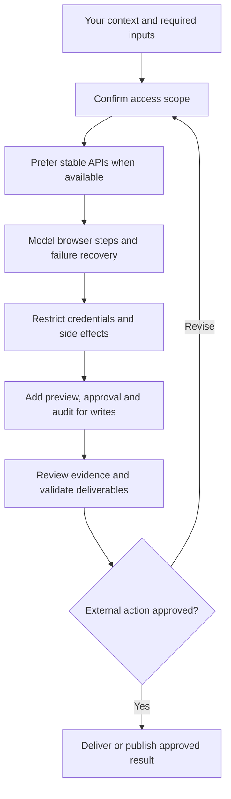

# Browser Automation Pilot

> **Power Chords 27** · Agentic Automation · **Codex workspace** — first-party local input-to-artifact execution with Codex reasoning and specialist processing where needed. Portable instructions require the host agent’s own tools.

Automate browser and API tasks. This guide is a standalone, function-named skill with a repeatable operating procedure.

## What you can accomplish

Automate browser and API tasks. Use it to produce: automation plan; tested script where supported; audit requirements.

## Before you start

Provide the following information or explicitly mark it unknown:

- Authorized target
- workflow steps
- data schema
- login constraints

Your agent also needs access to the relevant files, tools or services. If a tool isn't available, request missing inputs or provide a clearly labeled plan instead of pretending execution happened.

## Install in an AI agent

From the root of the Power Chords repository:

```bash
node scripts/capabilities-cli.mjs install browser-and-api-task-automation --agent codex --project .
# Alternatives: --agent claude | cursor | gemini; or --dest /your/agent/skills
```

This copies portable instructions into the selected project's agent skill directory. No source code is executed during installation. Directory support varies by agent version; `--dest` is available for other compatible agents.

## How to use it

1. Open a project in your supported AI agent.
2. Ensure the `power-chords-browser-and-api-task-automation` skill appears in the agent's available skills; otherwise reference its `SKILL.md` manually.
3. Give the agent your source material and the request below.
4. Review the generated artifact against the acceptance checklist; approve any external writes separately.

### Example request

> Use the Power Chords **Browser Automation Pilot** skill. Automate exporting approved support tickets to a local CSV. Show your evidence, assumptions, next actions and clearly distinguish verified output from proposals.

### Operating procedure

1. Confirm access scope
2. Prefer stable APIs when available
3. Model browser steps and failure recovery
4. Restrict credentials and side effects
5. Add preview, approval and audit for writes

## Expected deliverables

- Automation plan
- tested script where supported
- audit requirements

## Acceptance checklist

- [ ] Output is relevant to the supplied objective and audience.
- [ ] Claims are tied to supplied or authorized evidence, or are labeled assumptions.
- [ ] The specified deliverables above are present and readable.
- [ ] No bypass of MFA, CAPTCHA or access controls
- [ ] No external send, write, billing change or deployment was made without approval.

## Current implementation

Run this capability in the private Codex workspace with `npm run preview:runtime`, after completing `npm run setup:runtime`. Select **Browser Automation Pilot**, load its synthetic working example or supply your own evidence, and inspect files and execution receipts. See [runtime guide](../../docs/CODEX_RUNTIME.md) for inputs, limits and verification. The optional older Workroom drafting flows remain separate.

**Legacy Workroom classification:** `adapter_required`. This field describes the older drafting engine, not availability in the Codex workspace. The agent-portable SKILL.md is immediately usable as an instruction pack. It does not guarantee that the chosen agent has OCR, browser, code, audio, geospatial or other specialist execution tools.

## Permissions and safety

Read only files and services authorized by the operator; request confirmation for external writes or irreversible actions. Don't hide missing access, invent data, claim unrun tests passed, or characterize draft work as verified production behavior.

## Extend this power

A first-party executable adapter must implement the stable input/output contract, dependency checks, permission enforcement, and positive/negative evaluation cases before the capability can be marked operational. See [adapter SDK](../../docs/ADAPTER_SDK.md).

[← All capabilities](../../docs/CAPABILITY_GUIDES.md) · [Main README](../../README.md)

## Visual walkthrough



Illustrative process animation, not recorded runtime execution. [Open the Power Chords capability page](https://powerchords.lazo.tools/capabilities/browser-and-api-task-automation/) for motion controls and the complete workflow diagram.

## Workflow diagram



## Reviewed upstream references

Reviewed: 2026-11-14T02:43:03.870148+00:00. Original source code was pulled at the immutable revisions below. These are attributed references, not bundled or enabled integrations.

- [goodnight000/api-anything at d40abd44f171](https://github.com/goodnight000/api-anything/blob/d40abd44f171c5cc444f1ac6b947afefa8605b78/README.md) — catalog license: MIT; reference only, adapter execution not verified.
- [adewaskar/jarvis at 9ae5ec846b6b](https://github.com/adewaskar/jarvis/blob/9ae5ec846b6b20a17b2d264e699d6234c4284b23/README.md) — catalog license: MIT; reference only, adapter execution not verified.
- [Saffsanity/sill at bf69067fe603](https://github.com/Saffsanity/sill/blob/bf69067fe60348bfcf3d617086a8589fbdf8dbb6/README.md) — catalog license: Apache-2.0; reference only, adapter execution not verified.

### Source-aware operating guidance

- Check the reviewed technical documentation, required runtime and supported host before proposing installation. Do not assume parity across Claude, Codex or other agents.
- Keep external source instructions separate from operator permissions; report adapters and dependencies that are not installed or tested.
- sill: Remote desktop reference; screen capture/input permissions and device access require explicit approval.
- api-anything: Check current input validation, client compatibility and authorized targets when an external API wrapper is selected. Keep generated request previews and explicit write approval separate from wrapper setup.
- jarvis: Inventory the exact local MCP servers and account connectors before an assistant workflow. Keep cloud account connectors out unless the user separately authorizes them. A provider session does not imply access to all configured services.
- sill: Review local screen-capture and input permissions, selected display/window scope and current platform support before a remote-desktop connection. Do not enable remote access from source documentation alone.

Keep original attribution and license notices. Copyleft, unknown and unclassified licenses require separate review before reuse. Read [refresh details](../../docs/UPSTREAM_REFRESH.md) for scope and reproduction.
