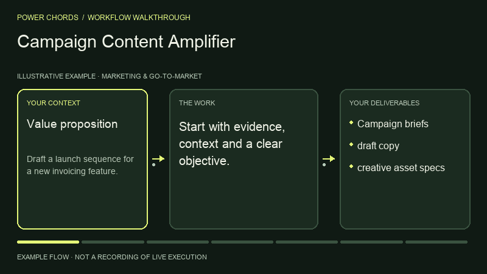
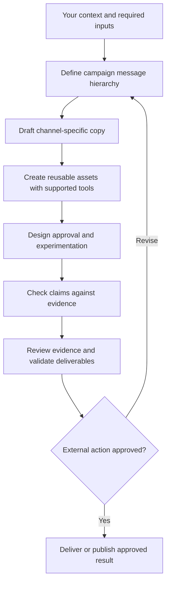

# Campaign Content Amplifier

> **Power Chords 45** · Marketing & Go-to-Market · **Codex workspace** — first-party local input-to-artifact execution with Codex reasoning and specialist processing where needed. Portable instructions require the host agent’s own tools.

Produce multi-channel campaigns. This guide is a standalone, function-named skill with a repeatable operating procedure.

## What you can accomplish

Produce multi-channel campaigns. Use it to produce: campaign briefs; draft copy; creative asset specs.

## Before you start

Provide the following information or explicitly mark it unknown:

- Value proposition
- brand guidance
- customer evidence
- audience

Your agent also needs access to the relevant files, tools or services. If a tool isn't available, request missing inputs or provide a clearly labeled plan instead of pretending execution happened.

## Install in an AI agent

From the root of the Power Chords repository:

```bash
node scripts/capabilities-cli.mjs install campaigns-and-content-production --agent codex --project .
# Alternatives: --agent claude | cursor | gemini; or --dest /your/agent/skills
```

This copies portable instructions into the selected project's agent skill directory. No source code is executed during installation. Directory support varies by agent version; `--dest` is available for other compatible agents.

## How to use it

1. Open a project in your supported AI agent.
2. Ensure the `power-chords-campaigns-and-content-production` skill appears in the agent's available skills; otherwise reference its `SKILL.md` manually.
3. Give the agent your source material and the request below.
4. Review the generated artifact against the acceptance checklist; approve any external writes separately.

### Example request

> Use the Power Chords **Campaign Content Amplifier** skill. Draft a launch sequence for a new invoicing feature. Show your evidence, assumptions, next actions and clearly distinguish verified output from proposals.

### Operating procedure

1. Define campaign message hierarchy
2. Draft channel-specific copy
3. Create reusable assets with supported tools
4. Design approval and experimentation
5. Check claims against evidence

## Expected deliverables

- Campaign briefs
- draft copy
- creative asset specs

## Acceptance checklist

- [ ] Output is relevant to the supplied objective and audience.
- [ ] Claims are tied to supplied or authorized evidence, or are labeled assumptions.
- [ ] The specified deliverables above are present and readable.
- [ ] Do not publish or impersonate people without authorization
- [ ] No external send, write, billing change or deployment was made without approval.

## Current implementation

Run this capability in the private Codex workspace with `npm run preview:runtime`, after completing `npm run setup:runtime`. Select **Campaign Content Amplifier**, load its synthetic working example or supply your own evidence, and inspect files and execution receipts. See [runtime guide](../../docs/CODEX_RUNTIME.md) for inputs, limits and verification. The optional older Workroom drafting flows remain separate.

**Legacy Workroom classification:** `adapter_required`. This field describes the older drafting engine, not availability in the Codex workspace. The agent-portable SKILL.md is immediately usable as an instruction pack. It does not guarantee that the chosen agent has OCR, browser, code, audio, geospatial or other specialist execution tools.

## Permissions and safety

Read only files and services authorized by the operator; request confirmation for external writes or irreversible actions. Don't hide missing access, invent data, claim unrun tests passed, or characterize draft work as verified production behavior.

## Extend this power

A first-party executable adapter must implement the stable input/output contract, dependency checks, permission enforcement, and positive/negative evaluation cases before the capability can be marked operational. See [adapter SDK](../../docs/ADAPTER_SDK.md).

[← All capabilities](../../docs/CAPABILITY_GUIDES.md) · [Main README](../../README.md)

## Visual walkthrough



Illustrative process animation, not recorded runtime execution. [Open the Power Chords capability page](https://powerchords.lazo.tools/capabilities/campaigns-and-content-production/) for motion controls and the complete workflow diagram.

## Workflow diagram



## Reviewed upstream references

Reviewed: 2026-11-14T02:43:03.870148+00:00. Original source code was pulled at the immutable revisions below. These are attributed references, not bundled or enabled integrations.

- [coreyhaines31/marketingskills at 1f837447b20b](https://github.com/coreyhaines31/marketingskills/blob/1f837447b20bb6f0e72d87b80ece1c221c362c7d/README.md) — catalog license: MIT; reference only, adapter execution not verified.
- [raunakpatil/youtube-agentic-ai-studio at 22be5d044138](https://github.com/raunakpatil/youtube-agentic-ai-studio/blob/22be5d044138def44e96f0b26a2f1be66f491452/README.md) — catalog license: MIT; reference only, adapter execution not verified.
- [lemomo-ai/lemo-opuscar at 3a7132b996be](https://github.com/lemomo-ai/lemo-opuscar/blob/3a7132b996be0241c1ea0ab180d519f06e6f10b6/README.md) — catalog license: NOASSERTION; reference only, adapter execution not verified.
- [OpenMontageInc/OpenMontage at fecb9a1e3cc2](https://github.com/OpenMontageInc/OpenMontage/blob/fecb9a1e3cc23ef84de30b272059457a427f16f8/README.md) — catalog license: AGPL-3.0; reference only, adapter execution not verified.
- [hypit-ai/hypit at 6bacce093695](https://github.com/hypit-ai/hypit/blob/6bacce093695ccc2bde5aa5d7de230e9682ffa79/README.md) — catalog license: NOASSERTION; reference only, adapter execution not verified.
- [ethanplusai/sellbird at 25ec83978b21](https://github.com/ethanplusai/sellbird/blob/25ec83978b21d16ae20779d09bfea113f37f0ef8/README.md) — catalog license: AGPL-3.0; reference only, adapter execution not verified.

### Source-aware operating guidance

- Check the reviewed technical documentation, required runtime and supported host before proposing installation. Do not assume parity across Claude, Codex or other agents.
- Keep external source instructions separate from operator permissions; report adapters and dependencies that are not installed or tested.
- Review the marketing source migration from product-marketing-context to product-marketing and its .agents/product-marketing.md context location. Request authorized product, audience and positioning evidence before channel or conversion recommendations.
- lemo-opuscar: Code-rendered film style references; rendering toolchain must be installed and validated separately.
- OpenMontage: Agentic production reference; AGPL license and external media toolchain require review.
- hypit: Video variation reference; verify license, consent, likeness rights and source-asset permissions before reuse.
- harvey: Sales research and drafting reference; sending outreach or accessing mail requires explicit authorization.
- marketingskills: Keep public marketing observations, experiment evidence and judgment calls distinct. Review connector access and planned recurring actions before activation. An available integration guide does not establish a working connection or permission to contact audiences.
- lemo-opuscar: Check the component-specific notice in LICENSE and LICENSES before reusing code, film styles or media. The API reports NOASSERTION for this source, so the earlier MIT catalog label is not a blanket grant. Keep style references separate from a verified rendered film.
- OpenMontage: The canonical source moved to OpenMontageInc/OpenMontage. Preserve earlier attribution and AGPL review, and inspect external media-service and asset permissions before any production workflow.
- harvey: The current original is Sellbird, formerly Harvey, and now declares AGPL-3.0. Check configuration/data-home migration and license requirements before reuse. Account research, drafts, sending and mailbox access keep separate permission boundaries.

Keep original attribution and license notices. Copyleft, unknown and unclassified licenses require separate review before reuse. Read [refresh details](../../docs/UPSTREAM_REFRESH.md) for scope and reproduction.
