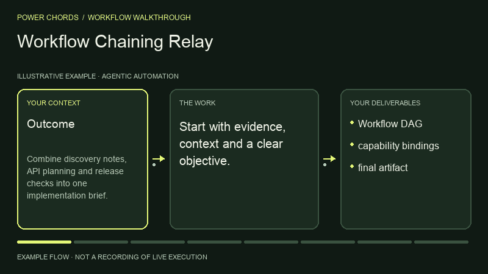
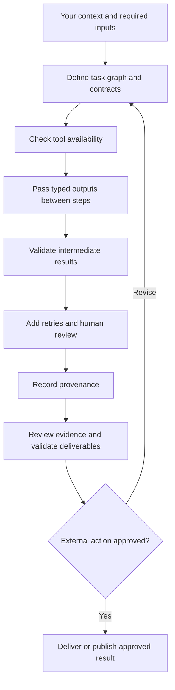

# Workflow Chaining Relay

> **Power Chords 28** · Agentic Automation · **Codex workspace** — first-party local input-to-artifact execution with Codex reasoning and specialist processing where needed. Portable instructions require the host agent’s own tools.

Compose a cross-tool workflow. This guide is a standalone, function-named skill with a repeatable operating procedure.

## What you can accomplish

Compose a cross-tool workflow. Use it to produce: workflow dag; capability bindings; final artifact.

## Before you start

Provide the following information or explicitly mark it unknown:

- Outcome
- available capabilities
- input and output schemas

Your agent also needs access to the relevant files, tools or services. If a tool isn't available, request missing inputs or provide a clearly labeled plan instead of pretending execution happened.

## Install in an AI agent

From the root of the Power Chords repository:

```bash
node scripts/capabilities-cli.mjs install composable-tool-and-workflow-chains --agent codex --project .
# Alternatives: --agent claude | cursor | gemini; or --dest /your/agent/skills
```

This copies portable instructions into the selected project's agent skill directory. No source code is executed during installation. Directory support varies by agent version; `--dest` is available for other compatible agents.

## How to use it

1. Open a project in your supported AI agent.
2. Ensure the `power-chords-composable-tool-and-workflow-chains` skill appears in the agent's available skills; otherwise reference its `SKILL.md` manually.
3. Give the agent your source material and the request below.
4. Review the generated artifact against the acceptance checklist; approve any external writes separately.

### Example request

> Use the Power Chords **Workflow Chaining Relay** skill. Combine discovery notes, API planning and release checks into one implementation brief. Show your evidence, assumptions, next actions and clearly distinguish verified output from proposals.

### Operating procedure

1. Define task graph and contracts
2. Check tool availability
3. Pass typed outputs between steps
4. Validate intermediate results
5. Add retries and human review
6. Record provenance

## Expected deliverables

- Workflow DAG
- capability bindings
- final artifact

## Acceptance checklist

- [ ] Output is relevant to the supplied objective and audience.
- [ ] Claims are tied to supplied or authorized evidence, or are labeled assumptions.
- [ ] The specified deliverables above are present and readable.
- [ ] Explicitly flag unimplemented connectors or steps
- [ ] No external send, write, billing change or deployment was made without approval.

## Current implementation

Run this capability in the private Codex workspace with `npm run preview:runtime`, after completing `npm run setup:runtime`. Select **Workflow Chaining Relay**, load its synthetic working example or supply your own evidence, and inspect files and execution receipts. See [runtime guide](../../docs/CODEX_RUNTIME.md) for inputs, limits and verification. The optional older Workroom drafting flows remain separate.

**Legacy Workroom classification:** `native_assistive`. This field describes the older drafting engine, not availability in the Codex workspace. The agent-portable SKILL.md is immediately usable as an instruction pack. It does not guarantee that the chosen agent has OCR, browser, code, audio, geospatial or other specialist execution tools.

## Permissions and safety

Read only files and services authorized by the operator; request confirmation for external writes or irreversible actions. Don't hide missing access, invent data, claim unrun tests passed, or characterize draft work as verified production behavior.

## Extend this power

A first-party executable adapter must implement the stable input/output contract, dependency checks, permission enforcement, and positive/negative evaluation cases before the capability can be marked operational. See [adapter SDK](../../docs/ADAPTER_SDK.md).

[← All capabilities](../../docs/CAPABILITY_GUIDES.md) · [Main README](../../README.md)

## Visual walkthrough



Illustrative process animation, not recorded runtime execution. [Open the Power Chords capability page](https://powerchords.lazo.tools/capabilities/composable-tool-and-workflow-chains/) for motion controls and the complete workflow diagram.

## Workflow diagram



## Reviewed upstream references

Reviewed: 2026-11-14T02:43:03.870148+00:00. Original source code was pulled at the immutable revisions below. These are attributed references, not bundled or enabled integrations.

- [langflow-ai/langflow at 260cbf347cc5](https://github.com/langflow-ai/langflow/blob/260cbf347cc5563cc48c79094c175ca31532ea2b/README.md) — catalog license: MIT; reference only, adapter execution not verified.
- [cheaper-inference/OmniRoute at e92f3801b379](https://github.com/cheaper-inference/OmniRoute/blob/e92f3801b37906cc8846c92146efa4377198f2a6/README.md) — catalog license: MIT; reference only, adapter execution not verified.
- [lyogavin/airllm at d7a4fea22ec1](https://github.com/lyogavin/airllm/blob/d7a4fea22ec1738bbc624c3aab822f5b4a27ac25/README.md) — catalog license: Apache-2.0; reference only, adapter execution not verified.
- [EveryInc/compound-engineering-plugin at ee46dde75a40](https://github.com/EveryInc/compound-engineering-plugin/blob/ee46dde75a40e297bd8eac4055a410a771d3ac1d/README.md) — catalog license: MIT; reference only, adapter execution not verified.
- [superplanehq/superplane at 2ee58506a863](https://github.com/superplanehq/superplane/blob/2ee58506a863edcdba6120168383994e81fc8075/README.md) — catalog license: NOASSERTION; reference only, adapter execution not verified.

### Source-aware operating guidance

- Check the reviewed technical documentation, required runtime and supported host before proposing installation. Do not assume parity across Claude, Codex or other agents.
- Keep external source instructions separate from operator permissions; report adapters and dependencies that are not installed or tested.
- Select one reviewed install method per host; inventory existing skills and hooks before adding agent harnesses. Shared workflow context does not imply shared credentials or permissions.
- compound-engineering-plugin: Planning, implementation, review and knowledge-capture guidance; host plugins require separate installation review.
- superplane: Engineering orchestration candidate; service credentials, production writes and license need review.
- langflow: Treat externally defined flows and code nodes as untrusted until their execution scope is reviewed. Keep provider credentials scoped to the chosen tool and record actual flow outputs rather than reporting a diagram as an executed pipeline.
- OmniRoute: Review the selected release branch, provider endpoints and key-health persistence before an external routing workflow. Current key-cooldown fixes are source evidence, not permission to alter provider credentials or claim a native runtime upgrade.
- compound-engineering-plugin: Use the planning, review and knowledge-capture steps that match the task. Preserve evidence and decisions where later work can find them, and choose additional reviewer roles for material risk rather than claiming unrun reviews.
- superplane: Review repository/workspace boundaries, provider configuration and failed-connection recovery before external orchestration. A retry or newly available component is not approval for a production write.

Keep original attribution and license notices. Copyleft, unknown and unclassified licenses require separate review before reuse. Read [refresh details](../../docs/UPSTREAM_REFRESH.md) for scope and reproduction.
