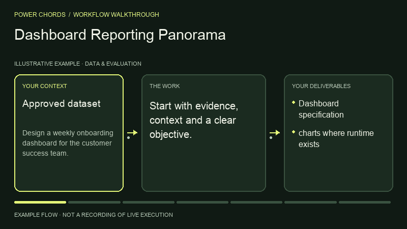
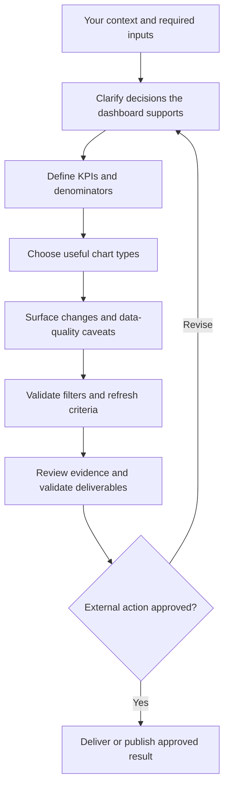

# Dashboard Reporting Panorama

> **Power Chords 31** · Data & Evaluation · **Codex workspace** — first-party local input-to-artifact execution with Codex reasoning and specialist processing where needed. Portable instructions require the host agent’s own tools.

Explain metrics visually. This guide is a standalone, function-named skill with a repeatable operating procedure.

## What you can accomplish

Explain metrics visually. Use it to produce: dashboard specification; charts where runtime exists.

## Before you start

Provide the following information or explicitly mark it unknown:

- Approved dataset
- metrics
- audience
- reporting cadence

Your agent also needs access to the relevant files, tools or services. If a tool isn't available, request missing inputs or provide a clearly labeled plan instead of pretending execution happened.

## Install in an AI agent

From the root of the Power Chords repository:

```bash
node scripts/capabilities-cli.mjs install dashboards-and-visual-reporting --agent codex --project .
# Alternatives: --agent claude | cursor | gemini; or --dest /your/agent/skills
```

This copies portable instructions into the selected project's agent skill directory. No source code is executed during installation. Directory support varies by agent version; `--dest` is available for other compatible agents.

## How to use it

1. Open a project in your supported AI agent.
2. Ensure the `power-chords-dashboards-and-visual-reporting` skill appears in the agent's available skills; otherwise reference its `SKILL.md` manually.
3. Give the agent your source material and the request below.
4. Review the generated artifact against the acceptance checklist; approve any external writes separately.

### Example request

> Use the Power Chords **Dashboard Reporting Panorama** skill. Design a weekly onboarding dashboard for the customer success team. Show your evidence, assumptions, next actions and clearly distinguish verified output from proposals.

### Operating procedure

1. Clarify decisions the dashboard supports
2. Define KPIs and denominators
3. Choose useful chart types
4. Surface changes and data-quality caveats
5. Validate filters and refresh criteria

## Expected deliverables

- Dashboard specification
- charts where runtime exists

## Acceptance checklist

- [ ] Output is relevant to the supplied objective and audience.
- [ ] Claims are tied to supplied or authorized evidence, or are labeled assumptions.
- [ ] The specified deliverables above are present and readable.
- [ ] No made-up live dashboard data or screenshots
- [ ] No external send, write, billing change or deployment was made without approval.

## Current implementation

Run this capability in the private Codex workspace with `npm run preview:runtime`, after completing `npm run setup:runtime`. Select **Dashboard Reporting Panorama**, load its synthetic working example or supply your own evidence, and inspect files and execution receipts. See [runtime guide](../../docs/CODEX_RUNTIME.md) for inputs, limits and verification. The optional older Workroom drafting flows remain separate.

**Legacy Workroom classification:** `adapter_required`. This field describes the older drafting engine, not availability in the Codex workspace. The agent-portable SKILL.md is immediately usable as an instruction pack. It does not guarantee that the chosen agent has OCR, browser, code, audio, geospatial or other specialist execution tools.

## Permissions and safety

Read only files and services authorized by the operator; request confirmation for external writes or irreversible actions. Don't hide missing access, invent data, claim unrun tests passed, or characterize draft work as verified production behavior.

## Extend this power

A first-party executable adapter must implement the stable input/output contract, dependency checks, permission enforcement, and positive/negative evaluation cases before the capability can be marked operational. See [adapter SDK](../../docs/ADAPTER_SDK.md).

[← All capabilities](../../docs/CAPABILITY_GUIDES.md) · [Main README](../../README.md)

## Visual walkthrough



Illustrative process animation, not recorded runtime execution. [Open the Power Chords capability page](https://powerchords.lazo.tools/capabilities/dashboards-and-visual-reporting/) for motion controls and the complete workflow diagram.

## Workflow diagram



## Reviewed upstream references

Reviewed: 2026-11-06T15:41:08.721Z. Original source code was pulled at the immutable revisions below. These are attributed references, not bundled or enabled integrations.

- [wheresryan22/anatomy at 1482e8469b0a](https://github.com/wheresryan22/anatomy/blob/1482e8469b0a9e0d8cc18ea2740a01423d29ae80/README.md) — catalog license: MIT; reference only, adapter execution not verified.
- [Bennettxai/FounderOS at a0b5db7eb6dc](https://github.com/Bennettxai/FounderOS/blob/a0b5db7eb6dcb52bb148b452557f454a2bc76082/README.md) — catalog license: MIT; reference only, adapter execution not verified.
- [umami-software/umami at 559e3c607c23](https://github.com/umami-software/umami/blob/559e3c607c23d2c72d9bd4f6481bda428255323c/README.md) — catalog license: MIT; reference only, adapter execution not verified.

### Source-aware operating guidance

- Check the reviewed technical documentation, required runtime and supported host before proposing installation. Do not assume parity across Claude, Codex or other agents.
- Keep external source instructions separate from operator permissions; report adapters and dependencies that are not installed or tested.
- umami: Analytics adapter candidate; collect events only after reviewing consent, retention, and deployment configuration.

Keep original attribution and license notices. Copyleft, unknown and unclassified licenses require separate review before reuse. Read [refresh details](../../docs/UPSTREAM_REFRESH.md) for scope and reproduction.
