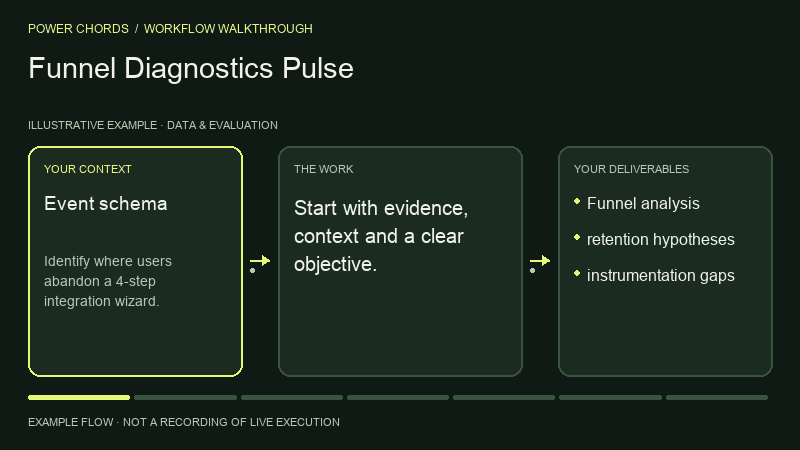
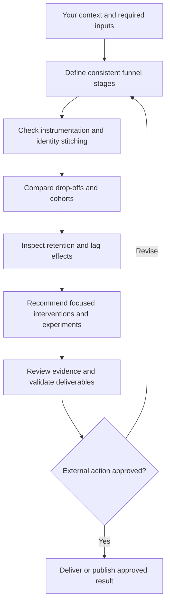

# Funnel Diagnostics Pulse

> **Power Chords 32** · Data & Evaluation · **Codex workspace** — first-party local input-to-artifact execution with Codex reasoning and specialist processing where needed. Portable instructions require the host agent’s own tools.

Diagnose product funnels. This guide is a standalone, function-named skill with a repeatable operating procedure.

## What you can accomplish

Diagnose product funnels. Use it to produce: funnel analysis; retention hypotheses; instrumentation gaps.

## Before you start

Provide the following information or explicitly mark it unknown:

- Event schema
- exposure logs
- time window
- cohorts

Your agent also needs access to the relevant files, tools or services. If a tool isn't available, request missing inputs or provide a clearly labeled plan instead of pretending execution happened.

## Install in an AI agent

From the root of the Power Chords repository:

```bash
node scripts/capabilities-cli.mjs install funnel-retention-and-operational-diagnostics --agent codex --project .
# Alternatives: --agent claude | cursor | gemini; or --dest /your/agent/skills
```

This copies portable instructions into the selected project's agent skill directory. No source code is executed during installation. Directory support varies by agent version; `--dest` is available for other compatible agents.

## How to use it

1. Open a project in your supported AI agent.
2. Ensure the `power-chords-funnel-retention-and-operational-diagnostics` skill appears in the agent's available skills; otherwise reference its `SKILL.md` manually.
3. Give the agent your source material and the request below.
4. Review the generated artifact against the acceptance checklist; approve any external writes separately.

### Example request

> Use the Power Chords **Funnel Diagnostics Pulse** skill. Identify where users abandon a 4-step integration wizard. Show your evidence, assumptions, next actions and clearly distinguish verified output from proposals.

### Operating procedure

1. Define consistent funnel stages
2. Check instrumentation and identity stitching
3. Compare drop-offs and cohorts
4. Inspect retention and lag effects
5. Recommend focused interventions and experiments

## Expected deliverables

- Funnel analysis
- retention hypotheses
- instrumentation gaps

## Acceptance checklist

- [ ] Output is relevant to the supplied objective and audience.
- [ ] Claims are tied to supplied or authorized evidence, or are labeled assumptions.
- [ ] The specified deliverables above are present and readable.
- [ ] State sampling, attribution and metric limitations
- [ ] No external send, write, billing change or deployment was made without approval.

## Current implementation

Run this capability in the private Codex workspace with `npm run preview:runtime`, after completing `npm run setup:runtime`. Select **Funnel Diagnostics Pulse**, load its synthetic working example or supply your own evidence, and inspect files and execution receipts. See [runtime guide](../../docs/CODEX_RUNTIME.md) for inputs, limits and verification. The optional older Workroom drafting flows remain separate.

**Legacy Workroom classification:** `native_assistive`. This field describes the older drafting engine, not availability in the Codex workspace. The agent-portable SKILL.md is immediately usable as an instruction pack. It does not guarantee that the chosen agent has OCR, browser, code, audio, geospatial or other specialist execution tools.

## Permissions and safety

Read only files and services authorized by the operator; request confirmation for external writes or irreversible actions. Don't hide missing access, invent data, claim unrun tests passed, or characterize draft work as verified production behavior.

## Extend this power

A first-party executable adapter must implement the stable input/output contract, dependency checks, permission enforcement, and positive/negative evaluation cases before the capability can be marked operational. See [adapter SDK](../../docs/ADAPTER_SDK.md).

[← All capabilities](../../docs/CAPABILITY_GUIDES.md) · [Main README](../../README.md)

## Visual walkthrough



Illustrative process animation, not recorded runtime execution. [Open the Power Chords capability page](https://powerchords.lazo.tools/capabilities/funnel-retention-and-operational-diagnostics/) for motion controls and the complete workflow diagram.

## Workflow diagram



## Reviewed upstream references

Reviewed: 2026-11-21T02:42:03.908069+00:00. Original source code was pulled at the immutable revisions below. These are attributed references, not bundled or enabled integrations.

- [coreyhaines31/marketingskills at 5b2b400eec1e](https://github.com/coreyhaines31/marketingskills/blob/5b2b400eec1e7e1cec76245a715d0b0d4fd2a9c1/README.md) — catalog license: MIT; reference only, adapter execution not verified.
- [anthropics/knowledge-work-plugins at 0e0fcacddcc8](https://github.com/anthropics/knowledge-work-plugins/blob/0e0fcacddcc892eb92a1b7873ff9d68159c47571/README.md) — catalog license: Apache-2.0; reference only, adapter execution not verified.
- [umami-software/umami at aad2c4cedd5c](https://github.com/umami-software/umami/blob/aad2c4cedd5c0b3bc4d361843830a0bb47cf79c4/README.md) — catalog license: MIT; reference only, adapter execution not verified.

### Source-aware operating guidance

- Check the reviewed technical documentation, required runtime and supported host before proposing installation. Do not assume parity across Claude, Codex or other agents.
- Keep external source instructions separate from operator permissions; report adapters and dependencies that are not installed or tested.
- umami: Before installing external analytics or collecting events, review database, secrets, deployment configuration, consent, data retention and access. Distinguish source events from acquisition and retention measures. This instruction pack does not configure an analytics server or default admin account.
- marketingskills: Keep public marketing observations, experiment evidence and judgment calls distinct. Review connector access and planned recurring actions before activation. An available integration guide does not establish a working connection or permission to contact audiences. Check vendor-guide claims against the provider’s primary documentation when they affect a decision. Disclose relevant commercial relationships, distinguish tool fit from a recommendation, and verify actual connector access rather than relying on a registry label.
- knowledge-work-plugins: Treat newly available role workflows and invoice-follow-up guidance as host-specific references. Review connector and recipient scope before any external action. Loading a specialist procedure does not grant its plugins access.

Keep original attribution and license notices. Copyleft, unknown and unclassified licenses require separate review before reuse. Read [refresh details](../../docs/UPSTREAM_REFRESH.md) for scope and reproduction.
