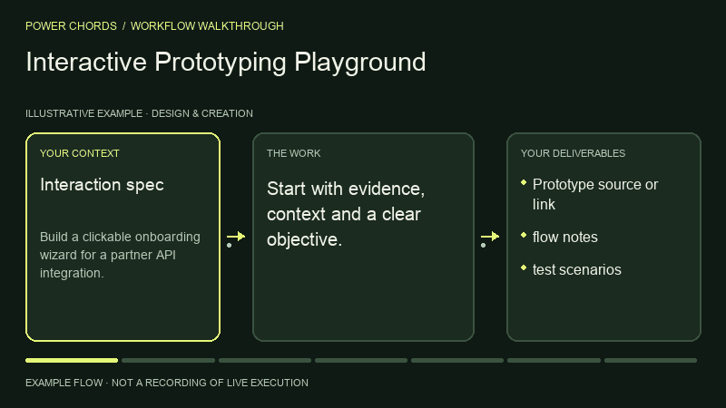
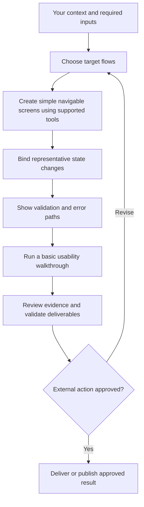

# Interactive Prototyping Playground

> **Power Chords 22** · Design & Creation · **Codex workspace** — first-party local input-to-artifact execution with Codex reasoning and specialist processing where needed. Portable instructions require the host agent’s own tools.

Build a clickable proof of concept. This guide is a standalone, function-named skill with a repeatable operating procedure.

## What you can accomplish

Build a clickable proof of concept. Use it to produce: prototype source or link; flow notes; test scenarios.

## Before you start

Provide the following information or explicitly mark it unknown:

- Interaction spec
- designs
- component library
- development environment

Your agent also needs access to the relevant files, tools or services. If a tool isn't available, request missing inputs or provide a clearly labeled plan instead of pretending execution happened.

## Install in an AI agent

From the root of the Power Chords repository:

```bash
node scripts/capabilities-cli.mjs install interactive-prototype-construction --agent codex --project .
# Alternatives: --agent claude | cursor | gemini; or --dest /your/agent/skills
```

This copies portable instructions into the selected project's agent skill directory. No source code is executed during installation. Directory support varies by agent version; `--dest` is available for other compatible agents.

## How to use it

1. Open a project in your supported AI agent.
2. Ensure the `power-chords-interactive-prototype-construction` skill appears in the agent's available skills; otherwise reference its `SKILL.md` manually.
3. Give the agent your source material and the request below.
4. Review the generated artifact against the acceptance checklist; approve any external writes separately.

### Example request

> Use the Power Chords **Interactive Prototyping Playground** skill. Build a clickable onboarding wizard for a partner API integration. Show your evidence, assumptions, next actions and clearly distinguish verified output from proposals.

### Operating procedure

1. Choose target flows
2. Create simple navigable screens using supported tools
3. Bind representative state changes
4. Show validation and error paths
5. Run a basic usability walkthrough

## Expected deliverables

- Prototype source or link
- flow notes
- test scenarios

## Acceptance checklist

- [ ] Output is relevant to the supplied objective and audience.
- [ ] Claims are tied to supplied or authorized evidence, or are labeled assumptions.
- [ ] The specified deliverables above are present and readable.
- [ ] Never claim clicks work when only static mockups were produced
- [ ] No external send, write, billing change or deployment was made without approval.

## Current implementation

Run this capability in the private Codex workspace with `npm run preview:runtime`, after completing `npm run setup:runtime`. Select **Interactive Prototyping Playground**, load its synthetic working example or supply your own evidence, and inspect files and execution receipts. See [runtime guide](../../docs/CODEX_RUNTIME.md) for inputs, limits and verification. The optional older Workroom drafting flows remain separate.

**Legacy Workroom classification:** `adapter_required`. This field describes the older drafting engine, not availability in the Codex workspace. The agent-portable SKILL.md is immediately usable as an instruction pack. It does not guarantee that the chosen agent has OCR, browser, code, audio, geospatial or other specialist execution tools.

## Permissions and safety

Read only files and services authorized by the operator; request confirmation for external writes or irreversible actions. Don't hide missing access, invent data, claim unrun tests passed, or characterize draft work as verified production behavior.

## Extend this power

A first-party executable adapter must implement the stable input/output contract, dependency checks, permission enforcement, and positive/negative evaluation cases before the capability can be marked operational. See [adapter SDK](../../docs/ADAPTER_SDK.md).

[← All capabilities](../../docs/CAPABILITY_GUIDES.md) · [Main README](../../README.md)

## Visual walkthrough



Illustrative process animation, not recorded runtime execution. [Open the Power Chords capability page](https://powerchords.lazo.tools/capabilities/interactive-prototype-construction/) for motion controls and the complete workflow diagram.

## Workflow diagram



## Reviewed upstream references

Reviewed: 2026-11-14T02:43:03.870148+00:00. Original source code was pulled at the immutable revisions below. These are attributed references, not bundled or enabled integrations.

- [Jakeschincariol/replica-skill at 77c9436fb3d1](https://github.com/Jakeschincariol/replica-skill/blob/77c9436fb3d18c3d58169efb8caf4fe906b0dc51/README.md) — catalog license: MIT; reference only, adapter execution not verified.
- [wheresryan22/anatomy at 1482e8469b0a](https://github.com/wheresryan22/anatomy/blob/1482e8469b0a9e0d8cc18ea2740a01423d29ae80/README.md) — catalog license: MIT; reference only, adapter execution not verified.
- [KonstantinKai/reelkit at 27fb5d7bea69](https://github.com/KonstantinKai/reelkit/blob/27fb5d7bea69d63bc5fa572c7f5a0f26127d7be7/README.md) — catalog license: MIT; reference only, adapter execution not verified.
- [heygen-com/hyperframes at 92816ed56bde](https://github.com/heygen-com/hyperframes/blob/92816ed56bde07affff0f6e0a5bce3dd96a96808/README.md) — catalog license: Apache-2.0; reference only, adapter execution not verified.
- [meta/astryx at 7b3154197a9a](https://github.com/meta/astryx/blob/7b3154197a9a9fca33d4aab859a6b35989d0e9cc/README.md) — catalog license: MIT; reference only, adapter execution not verified.
- [pbakaus/impeccable at acb4cfe14470](https://github.com/pbakaus/impeccable/blob/acb4cfe14470b1fdf51e855431af618d936b7db8/README.md) — catalog license: Apache-2.0; reference only, adapter execution not verified.

### Source-aware operating guidance

- Check the reviewed technical documentation, required runtime and supported host before proposing installation. Do not assume parity across Claude, Codex or other agents.
- Keep external source instructions separate from operator permissions; report adapters and dependencies that are not installed or tested.
- reelkit: Touch-first slider library reference; accessibility and input behavior need integration tests.
- hyperframes: HTML-to-video rendering adapter candidate; rendering and external tools remain separate dependencies.
- astryx: Check React 19 support and use the scoped @astryxdesign/cli when a React implementation is requested. Verify component documentation, theming, keyboard interaction and template output. The native isolated HTML preview does not install React or Astryx.
- impeccable: Use scoped critique, accessibility and design-check guidance without treating its output as a verified fix. Do not install hooks, download its engine or invoke live-copy fallback without separate review. Preserve Codex approvals and isolation.
- reelkit: Count core, framework binding and overlay requirements separately before selecting an external UI interaction component. Check keyboard, touch, accessibility and responsive behavior in the rendered target rather than assuming framework parity.
- hyperframes: Use the documented core skill set or an explicitly selected optional renderer integration. Check late assets, browser requirements and export results. Never install all optional skills or change telemetry merely because an upstream setup recipe suggests it.
- astryx: For a requested React interface, check React 19 compatibility and the scoped @astryxdesign/cli package before using component or template guidance. Verify theming, keyboard interaction and rendered states. The isolated HTML preview does not install this library.
- impeccable: Scope a design critique or deterministic interface check to a named surface and verify proposed changes in the rendered result. Do not install hooks, download an engine or invoke the live-copy fallback that disables approvals. Any future integration must preserve Codex approval and isolation.

Keep original attribution and license notices. Copyleft, unknown and unclassified licenses require separate review before reuse. Read [refresh details](../../docs/UPSTREAM_REFRESH.md) for scope and reproduction.
