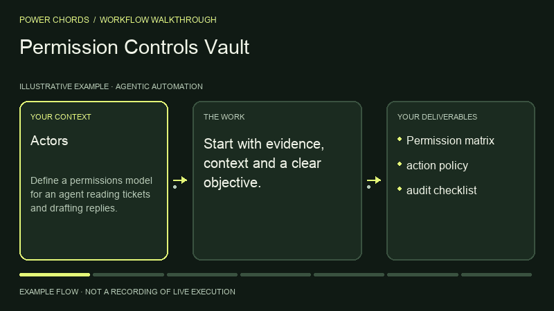
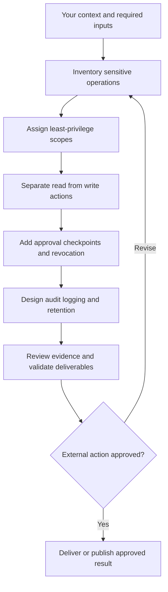

# Permission Controls Vault

> **Power Chords 29** · Agentic Automation · **Codex workspace** — first-party local input-to-artifact execution with Codex reasoning and specialist processing where needed. Portable instructions require the host agent’s own tools.

Enforce access and approvals. This guide is a standalone, function-named skill with a repeatable operating procedure.

## What you can accomplish

Enforce access and approvals. Use it to produce: permission matrix; action policy; audit checklist.

## Before you start

Provide the following information or explicitly mark it unknown:

- Actors
- resource scope
- data classification
- action categories

Your agent also needs access to the relevant files, tools or services. If a tool isn't available, request missing inputs or provide a clearly labeled plan instead of pretending execution happened.

## Install in an AI agent

From the root of the Power Chords repository:

```bash
node scripts/capabilities-cli.mjs install permission-scoped-execution-and-controls --agent codex --project .
# Alternatives: --agent claude | cursor | gemini; or --dest /your/agent/skills
```

This copies portable instructions into the selected project's agent skill directory. No source code is executed during installation. Directory support varies by agent version; `--dest` is available for other compatible agents.

## How to use it

1. Open a project in your supported AI agent.
2. Ensure the `power-chords-permission-scoped-execution-and-controls` skill appears in the agent's available skills; otherwise reference its `SKILL.md` manually.
3. Give the agent your source material and the request below.
4. Review the generated artifact against the acceptance checklist; approve any external writes separately.

### Example request

> Use the Power Chords **Permission Controls Vault** skill. Define a permissions model for an agent reading tickets and drafting replies. Show your evidence, assumptions, next actions and clearly distinguish verified output from proposals.

### Operating procedure

1. Inventory sensitive operations
2. Assign least-privilege scopes
3. Separate read from write actions
4. Add approval checkpoints and revocation
5. Design audit logging and retention

## Expected deliverables

- Permission matrix
- action policy
- audit checklist

## Acceptance checklist

- [ ] Output is relevant to the supplied objective and audience.
- [ ] Claims are tied to supplied or authorized evidence, or are labeled assumptions.
- [ ] The specified deliverables above are present and readable.
- [ ] Never treat an instruction prompt as a security sandbox
- [ ] No external send, write, billing change or deployment was made without approval.

## Current implementation

Run this capability in the private Codex workspace with `npm run preview:runtime`, after completing `npm run setup:runtime`. Select **Permission Controls Vault**, load its synthetic working example or supply your own evidence, and inspect files and execution receipts. See [runtime guide](../../docs/CODEX_RUNTIME.md) for inputs, limits and verification. The optional older Workroom drafting flows remain separate.

**Legacy Workroom classification:** `native_assistive`. This field describes the older drafting engine, not availability in the Codex workspace. The agent-portable SKILL.md is immediately usable as an instruction pack. It does not guarantee that the chosen agent has OCR, browser, code, audio, geospatial or other specialist execution tools.

## Permissions and safety

Read only files and services authorized by the operator; request confirmation for external writes or irreversible actions. Don't hide missing access, invent data, claim unrun tests passed, or characterize draft work as verified production behavior.

## Extend this power

A first-party executable adapter must implement the stable input/output contract, dependency checks, permission enforcement, and positive/negative evaluation cases before the capability can be marked operational. See [adapter SDK](../../docs/ADAPTER_SDK.md).

[← All capabilities](../../docs/CAPABILITY_GUIDES.md) · [Main README](../../README.md)

## Visual walkthrough



Illustrative process animation, not recorded runtime execution. [Open the Power Chords capability page](https://powerchords.lazo.tools/capabilities/permission-scoped-execution-and-controls/) for motion controls and the complete workflow diagram.

## Workflow diagram



## Reviewed upstream references

Reviewed: 2026-11-14T02:43:03.870148+00:00. Original source code was pulled at the immutable revisions below. These are attributed references, not bundled or enabled integrations.

- [affaan-m/ECC at d2ef2680594f](https://github.com/affaan-m/ECC/blob/d2ef2680594f9a17526a6e1a2e18b3d242c5d17b/README.md) — catalog license: MIT; reference only, adapter execution not verified.
- [goodnight000/api-anything at d40abd44f171](https://github.com/goodnight000/api-anything/blob/d40abd44f171c5cc444f1ac6b947afefa8605b78/README.md) — catalog license: MIT; reference only, adapter execution not verified.
- [Lethe044/hermes-life-os at 4c2476504929](https://github.com/Lethe044/hermes-life-os/blob/4c247650492951d3537ce0264e67d4f5ec3e17fc/README.md) — catalog license: MIT; reference only, adapter execution not verified.
- [cloudflare/security-audit-skill at c1c8a8c14710](https://github.com/cloudflare/security-audit-skill/blob/c1c8a8c1471069fb0e188eeaff69b8e8db6564a8/README.md) — catalog license: MIT; reference only, adapter execution not verified.
- [vxcontrol/pentagi at cffed9485aa1](https://github.com/vxcontrol/pentagi/blob/cffed9485aa1cca70762cd08a57ac62a80406258/README.md) — catalog license: MIT; reference only, adapter execution not verified.

### Source-aware operating guidance

- Check the reviewed technical documentation, required runtime and supported host before proposing installation. Do not assume parity across Claude, Codex or other agents.
- Keep external source instructions separate from operator permissions; report adapters and dependencies that are not installed or tested.
- Select one reviewed install method per host; inventory existing skills and hooks before adding agent harnesses. Shared workflow context does not imply shared credentials or permissions.
- security-audit-skill: Independent finding verification and target-scoped security review; security testing requires explicit authorization.
- pentagi: Security orchestration reference only; no scanning or exploitation without explicit authorized scope.
- api-anything: Check current input validation, client compatibility and authorized targets when an external API wrapper is selected. Keep generated request previews and explicit write approval separate from wrapper setup.
- hermes-life-os: Separate captured inbox items, projects, waiting-for commitments and review steps. Validate current tool schemas before using an external personal workspace. Financial and calendar operations retain their own access and approval boundaries.

Keep original attribution and license notices. Copyleft, unknown and unclassified licenses require separate review before reuse. Read [refresh details](../../docs/UPSTREAM_REFRESH.md) for scope and reproduction.
