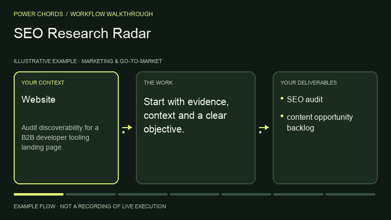
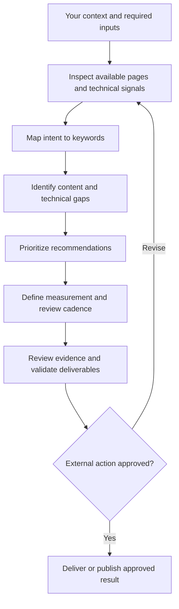

# SEO Research Radar

> **Power Chords 43** · Marketing & Go-to-Market · **Codex workspace** — first-party local input-to-artifact execution with Codex reasoning and specialist processing where needed. Portable instructions require the host agent’s own tools.

Audit discoverability and SEO. This guide is a standalone, function-named skill with a repeatable operating procedure.

## What you can accomplish

Audit discoverability and SEO. Use it to produce: seo audit; content opportunity backlog.

## Before you start

Provide the following information or explicitly mark it unknown:

- Website
- audience
- target keywords
- performance metrics

Your agent also needs access to the relevant files, tools or services. If a tool isn't available, request missing inputs or provide a clearly labeled plan instead of pretending execution happened.

## Install in an AI agent

From the root of the Power Chords repository:

```bash
node scripts/capabilities-cli.mjs install seo-and-discoverability-research --agent codex --project .
# Alternatives: --agent claude | cursor | gemini; or --dest /your/agent/skills
```

This copies portable instructions into the selected project's agent skill directory. No source code is executed during installation. Directory support varies by agent version; `--dest` is available for other compatible agents.

## How to use it

1. Open a project in your supported AI agent.
2. Ensure the `power-chords-seo-and-discoverability-research` skill appears in the agent's available skills; otherwise reference its `SKILL.md` manually.
3. Give the agent your source material and the request below.
4. Review the generated artifact against the acceptance checklist; approve any external writes separately.

### Example request

> Use the Power Chords **SEO Research Radar** skill. Audit discoverability for a B2B developer tooling landing page. Show your evidence, assumptions, next actions and clearly distinguish verified output from proposals.

### Operating procedure

1. Inspect available pages and technical signals
2. Map intent to keywords
3. Identify content and technical gaps
4. Prioritize recommendations
5. Define measurement and review cadence

## Expected deliverables

- SEO audit
- content opportunity backlog

## Acceptance checklist

- [ ] Output is relevant to the supplied objective and audience.
- [ ] Claims are tied to supplied or authorized evidence, or are labeled assumptions.
- [ ] The specified deliverables above are present and readable.
- [ ] Current ranking or traffic claims need fresh measurements
- [ ] No external send, write, billing change or deployment was made without approval.

## Current implementation

Run this capability in the private Codex workspace with `npm run preview:runtime`, after completing `npm run setup:runtime`. Select **SEO Research Radar**, load its synthetic working example or supply your own evidence, and inspect files and execution receipts. See [runtime guide](../../docs/CODEX_RUNTIME.md) for inputs, limits and verification. The optional older Workroom drafting flows remain separate.

**Legacy Workroom classification:** `adapter_required`. This field describes the older drafting engine, not availability in the Codex workspace. The agent-portable SKILL.md is immediately usable as an instruction pack. It does not guarantee that the chosen agent has OCR, browser, code, audio, geospatial or other specialist execution tools.

## Permissions and safety

Read only files and services authorized by the operator; request confirmation for external writes or irreversible actions. Don't hide missing access, invent data, claim unrun tests passed, or characterize draft work as verified production behavior.

## Extend this power

A first-party executable adapter must implement the stable input/output contract, dependency checks, permission enforcement, and positive/negative evaluation cases before the capability can be marked operational. See [adapter SDK](../../docs/ADAPTER_SDK.md).

[← All capabilities](../../docs/CAPABILITY_GUIDES.md) · [Main README](../../README.md)

## Visual walkthrough



Illustrative process animation, not recorded runtime execution. [Open the Power Chords capability page](https://powerchords.lazo.tools/capabilities/seo-and-discoverability-research/) for motion controls and the complete workflow diagram.

## Workflow diagram



## Reviewed upstream references

Reviewed: 2026-11-21T02:42:03.908069+00:00. Original source code was pulled at the immutable revisions below. These are attributed references, not bundled or enabled integrations.

- [every-app/open-seo at af3f995fe3eb](https://github.com/every-app/open-seo/blob/af3f995fe3ebbe21298df152465a5436842354ee/README.md) — catalog license: MIT; reference only, adapter execution not verified.
- [coreyhaines31/marketingskills at 5b2b400eec1e](https://github.com/coreyhaines31/marketingskills/blob/5b2b400eec1e7e1cec76245a715d0b0d4fd2a9c1/README.md) — catalog license: MIT; reference only, adapter execution not verified.
- [AgriciDaniel/claude-seo at 468ed5b0d9e3](https://github.com/AgriciDaniel/claude-seo/blob/468ed5b0d9e3249394783710e54abb02837e326b/README.md) — catalog license: MIT; reference only, adapter execution not verified.
- [zubair-trabzada/geo-seo-claude at 989cae01e8eb](https://github.com/zubair-trabzada/geo-seo-claude/blob/989cae01e8ebbc42a9ec798eb9e7cb423f5ec89c/README.md) — catalog license: MIT; reference only, adapter execution not verified.

### Source-aware operating guidance

- Check the reviewed technical documentation, required runtime and supported host before proposing installation. Do not assume parity across Claude, Codex or other agents.
- Keep external source instructions separate from operator permissions; report adapters and dependencies that are not installed or tested.
- Review the marketing source migration from product-marketing-context to product-marketing and its .agents/product-marketing.md context location. Request authorized product, audience and positioning evidence before channel or conversion recommendations.
- claude-seo: SEO audit instruction references; live connectors and specialist agents are not automatically enabled. Keep an explicitly authorized local audit target separate from untrusted cross-origin links. Recheck proxy and redirect destinations, and do not treat a trusted proxy as permission to fetch private targets.
- geo-seo-claude: AI-search optimization guidance; report observed crawl/citation evidence without guaranteeing rankings.
- open-seo: Separate observed public page evidence from paid or authenticated research. Review connector consent, credit limits and public-URL validation before external SEO tools. Preserve the provider and request that produced each finding.
- marketingskills: Keep public marketing observations, experiment evidence and judgment calls distinct. Review connector access and planned recurring actions before activation. An available integration guide does not establish a working connection or permission to contact audiences. Check vendor-guide claims against the provider’s primary documentation when they affect a decision. Disclose relevant commercial relationships, distinguish tool fit from a recommendation, and verify actual connector access rather than relying on a registry label.

Keep original attribution and license notices. Copyleft, unknown and unclassified licenses require separate review before reuse. Read [refresh details](../../docs/UPSTREAM_REFRESH.md) for scope and reproduction.
