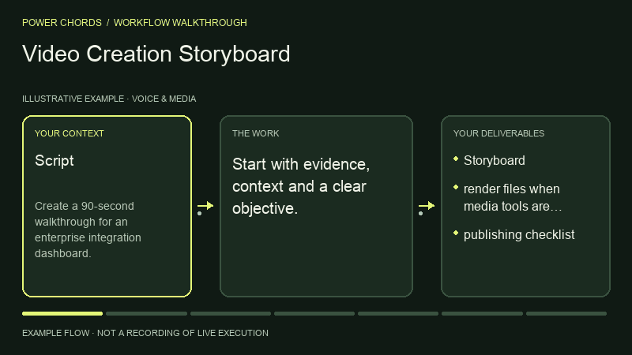
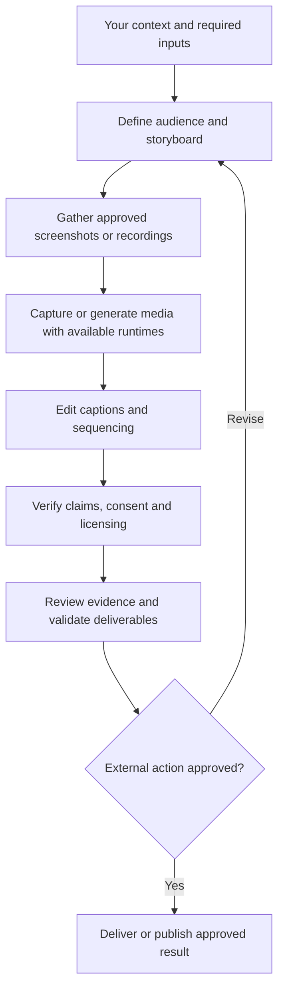

# Video Creation Storyboard

> **Power Chords 42** · Voice & Media · **Codex workspace** — first-party local input-to-artifact execution with Codex reasoning and specialist processing where needed. Portable instructions require the host agent’s own tools.

Create explainers and product demos. This guide is a standalone, function-named skill with a repeatable operating procedure.

## What you can accomplish

Create explainers and product demos. Use it to produce: storyboard; render files when media tools are available; publishing checklist.

## Before you start

Provide the following information or explicitly mark it unknown:

- Script
- product access
- assets
- target channels

Your agent also needs access to the relevant files, tools or services. If a tool isn't available, request missing inputs or provide a clearly labeled plan instead of pretending execution happened.

## Install in an AI agent

From the root of the Power Chords repository:

```bash
node scripts/capabilities-cli.mjs install video-demos-and-educational-content --agent codex --project .
# Alternatives: --agent claude | cursor | gemini; or --dest /your/agent/skills
```

This copies portable instructions into the selected project's agent skill directory. No source code is executed during installation. Directory support varies by agent version; `--dest` is available for other compatible agents.

## How to use it

1. Open a project in your supported AI agent.
2. Ensure the `power-chords-video-demos-and-educational-content` skill appears in the agent's available skills; otherwise reference its `SKILL.md` manually.
3. Give the agent your source material and the request below.
4. Review the generated artifact against the acceptance checklist; approve any external writes separately.

### Example request

> Use the Power Chords **Video Creation Storyboard** skill. Create a 90-second walkthrough for an enterprise integration dashboard. Show your evidence, assumptions, next actions and clearly distinguish verified output from proposals.

### Operating procedure

1. Define audience and storyboard
2. Gather approved screenshots or recordings
3. Capture or generate media with available runtimes
4. Edit captions and sequencing
5. Verify claims, consent and licensing

## Expected deliverables

- Storyboard
- render files when media tools are available
- publishing checklist

## Acceptance checklist

- [ ] Output is relevant to the supplied objective and audience.
- [ ] Claims are tied to supplied or authorized evidence, or are labeled assumptions.
- [ ] The specified deliverables above are present and readable.
- [ ] Publishing and external uploads require approval
- [ ] No external send, write, billing change or deployment was made without approval.

## Current implementation

Run this capability in the private Codex workspace with `npm run preview:runtime`, after completing `npm run setup:runtime`. Select **Video Creation Storyboard**, load its synthetic working example or supply your own evidence, and inspect files and execution receipts. See [runtime guide](../../docs/CODEX_RUNTIME.md) for inputs, limits and verification. The optional older Workroom drafting flows remain separate.

**Legacy Workroom classification:** `adapter_required`. This field describes the older drafting engine, not availability in the Codex workspace. The agent-portable SKILL.md is immediately usable as an instruction pack. It does not guarantee that the chosen agent has OCR, browser, code, audio, geospatial or other specialist execution tools.

## Permissions and safety

Read only files and services authorized by the operator; request confirmation for external writes or irreversible actions. Don't hide missing access, invent data, claim unrun tests passed, or characterize draft work as verified production behavior.

## Extend this power

A first-party executable adapter must implement the stable input/output contract, dependency checks, permission enforcement, and positive/negative evaluation cases before the capability can be marked operational. See [adapter SDK](../../docs/ADAPTER_SDK.md).

[← All capabilities](../../docs/CAPABILITY_GUIDES.md) · [Main README](../../README.md)

## Visual walkthrough



Illustrative process animation, not recorded runtime execution. [Open the Power Chords capability page](https://powerchords.lazo.tools/capabilities/video-demos-and-educational-content/) for motion controls and the complete workflow diagram.

## Workflow diagram



## Reviewed upstream references

Reviewed: 2026-11-06T15:41:08.721Z. Original source code was pulled at the immutable revisions below. These are attributed references, not bundled or enabled integrations.

- [webadderallorg/Recordly at 109ca3a13c36](https://github.com/webadderallorg/Recordly/blob/109ca3a13c362e969d9add25d1f93406c36dba2a/README.md) — catalog license: NOASSERTION; reference only, adapter execution not verified.
- [raunakpatil/youtube-agentic-ai-studio at 22be5d044138](https://github.com/raunakpatil/youtube-agentic-ai-studio/blob/22be5d044138def44e96f0b26a2f1be66f491452/README.md) — catalog license: MIT; reference only, adapter execution not verified.
- [darkzOGx/youtube-automation-agent at e973d515aef9](https://github.com/darkzOGx/youtube-automation-agent/blob/e973d515aef90c467da2289144df737a3bd03859/README.md) — catalog license: MIT; reference only, adapter execution not verified.
- [lemomo-ai/lemo-opuscar at bebbbe1aa92a](https://github.com/lemomo-ai/lemo-opuscar/blob/bebbbe1aa92a3cb4bb6f83500e61b23a17d1aa00/README.md) — catalog license: MIT; reference only, adapter execution not verified.
- [calesthio/OpenMontage at d21f5d4eaa08](https://github.com/calesthio/OpenMontage/blob/d21f5d4eaa08422b09c7091757a05affcbabb35b/README.md) — catalog license: AGPL-3.0; reference only, adapter execution not verified.
- [alchaincyf/huashu-art-motion at 8a0d7d72ca65](https://github.com/alchaincyf/huashu-art-motion/blob/8a0d7d72ca65fcce6f8ba82c4a6c8dfe35b8422c/README.md) — catalog license: MIT; reference only, adapter execution not verified.
- [feitangyuan/onetake at abb6d17279cd](https://github.com/feitangyuan/onetake/blob/abb6d17279cdc749e27e99aa534a062d8fd01ced/README.md) — catalog license: NOASSERTION; reference only, adapter execution not verified.
- [heygen-com/hyperframes at a874a6324a5e](https://github.com/heygen-com/hyperframes/blob/a874a6324a5e3dec18ebfea426071f87a7f21373/README.md) — catalog license: Apache-2.0; reference only, adapter execution not verified.
- [hypit-ai/hypit at 2d31e88765e2](https://github.com/hypit-ai/hypit/blob/2d31e88765e297f0795348b460c77a6067f12261/README.md) — catalog license: NOASSERTION; reference only, adapter execution not verified.
- [Wan-Video/Wan2.2 at 1ea34ff48f87](https://github.com/Wan-Video/Wan2.2/blob/1ea34ff48f87168174e12956e200b1d908b1c5ff/README.md) — catalog license: Apache-2.0; reference only, adapter execution not verified.

### Source-aware operating guidance

- Check the reviewed technical documentation, required runtime and supported host before proposing installation. Do not assume parity across Claude, Codex or other agents.
- Keep external source instructions separate from operator permissions; report adapters and dependencies that are not installed or tested.
- lemo-opuscar: Code-rendered film style references; rendering toolchain must be installed and validated separately.
- OpenMontage: Agentic production reference; AGPL license and external media toolchain require review.
- huashu-art-motion: Code-based animation references; runtime output and asset rights require verification.
- onetake: Continuous-camera launch film reference; review license and verify continuity/rendering claims.
- hyperframes: HTML-to-video rendering adapter candidate; rendering and external tools remain separate dependencies.
- hypit: Video variation reference; verify license, consent, likeness rights and source-asset permissions before reuse.
- Wan2.2: Model-runtime candidate; model weights, hardware, dependency setup and asset rights are not bundled.

Keep original attribution and license notices. Copyleft, unknown and unclassified licenses require separate review before reuse. Read [refresh details](../../docs/UPSTREAM_REFRESH.md) for scope and reproduction.
