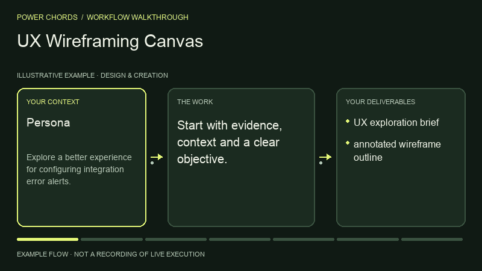
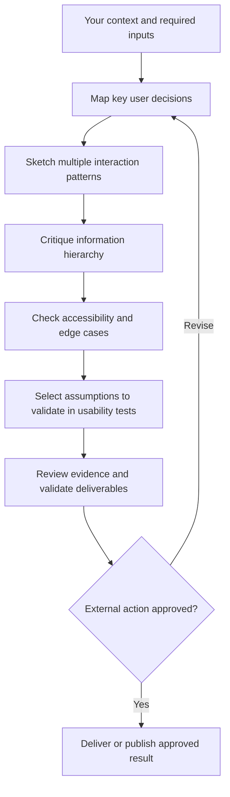

# UX Wireframing Canvas

> **Power Chords 21** · Design & Creation · **Codex workspace** — first-party local input-to-artifact execution with Codex reasoning and specialist processing where needed. Portable instructions require the host agent’s own tools.

Explore user experience options. This guide is a standalone, function-named skill with a repeatable operating procedure.

## What you can accomplish

Explore user experience options. Use it to produce: ux exploration brief; annotated wireframe outline.

## Before you start

Provide the following information or explicitly mark it unknown:

- Persona
- task
- accessibility needs
- current screen behavior

Your agent also needs access to the relevant files, tools or services. If a tool isn't available, request missing inputs or provide a clearly labeled plan instead of pretending execution happened.

## Install in an AI agent

From the root of the Power Chords repository:

```bash
node scripts/capabilities-cli.mjs install wireframing-and-ux-exploration --agent codex --project .
# Alternatives: --agent claude | cursor | gemini; or --dest /your/agent/skills
```

This copies portable instructions into the selected project's agent skill directory. No source code is executed during installation. Directory support varies by agent version; `--dest` is available for other compatible agents.

## How to use it

1. Open a project in your supported AI agent.
2. Ensure the `power-chords-wireframing-and-ux-exploration` skill appears in the agent's available skills; otherwise reference its `SKILL.md` manually.
3. Give the agent your source material and the request below.
4. Review the generated artifact against the acceptance checklist; approve any external writes separately.

### Example request

> Use the Power Chords **UX Wireframing Canvas** skill. Explore a better experience for configuring integration error alerts. Show your evidence, assumptions, next actions and clearly distinguish verified output from proposals.

### Operating procedure

1. Map key user decisions
2. Sketch multiple interaction patterns
3. Critique information hierarchy
4. Check accessibility and edge cases
5. Select assumptions to validate in usability tests

## Expected deliverables

- UX exploration brief
- annotated wireframe outline

## Acceptance checklist

- [ ] Output is relevant to the supplied objective and audience.
- [ ] Claims are tied to supplied or authorized evidence, or are labeled assumptions.
- [ ] The specified deliverables above are present and readable.
- [ ] Clearly mark conceptual wireframes versus tested designs
- [ ] No external send, write, billing change or deployment was made without approval.

## Current implementation

Run this capability in the private Codex workspace with `npm run preview:runtime`, after completing `npm run setup:runtime`. Select **UX Wireframing Canvas**, load its synthetic working example or supply your own evidence, and inspect files and execution receipts. See [runtime guide](../../docs/CODEX_RUNTIME.md) for inputs, limits and verification. The optional older Workroom drafting flows remain separate.

**Legacy Workroom classification:** `adapter_required`. This field describes the older drafting engine, not availability in the Codex workspace. The agent-portable SKILL.md is immediately usable as an instruction pack. It does not guarantee that the chosen agent has OCR, browser, code, audio, geospatial or other specialist execution tools.

## Permissions and safety

Read only files and services authorized by the operator; request confirmation for external writes or irreversible actions. Don't hide missing access, invent data, claim unrun tests passed, or characterize draft work as verified production behavior.

## Extend this power

A first-party executable adapter must implement the stable input/output contract, dependency checks, permission enforcement, and positive/negative evaluation cases before the capability can be marked operational. See [adapter SDK](../../docs/ADAPTER_SDK.md).

[← All capabilities](../../docs/CAPABILITY_GUIDES.md) · [Main README](../../README.md)

## Visual walkthrough



Illustrative process animation, not recorded runtime execution. [Open the Power Chords capability page](https://powerchords.lazo.tools/capabilities/wireframing-and-ux-exploration/) for motion controls and the complete workflow diagram.

## Workflow diagram



## Reviewed upstream references

Reviewed: 2026-11-21T02:42:03.908069+00:00. Original source code was pulled at the immutable revisions below. These are attributed references, not bundled or enabled integrations.

- [garrytan/gstack at 41729a023ecf](https://github.com/garrytan/gstack/blob/41729a023ecf4c8c41d95ad69c666f2fd619c8fb/README.md) — catalog license: MIT; reference only, adapter execution not verified.
- [addyosmani/agent-skills at 8c99fa36d900](https://github.com/addyosmani/agent-skills/blob/8c99fa36d90068c82d547f7c12a9d67a3e95f4ee/README.md) — catalog license: MIT; reference only, adapter execution not verified.
- [KonstantinKai/reelkit at f273e1228e2d](https://github.com/KonstantinKai/reelkit/blob/f273e1228e2de985af38939a25b957684503c5e3/README.md) — catalog license: MIT; reference only, adapter execution not verified.
- [meta/astryx at 51d94100f703](https://github.com/meta/astryx/blob/51d94100f703b70b46578b6ad6a5778831cc8f96/README.md) — catalog license: MIT; reference only, adapter execution not verified.
- [pbakaus/impeccable at b49177d32788](https://github.com/pbakaus/impeccable/blob/b49177d32788f2dc585c42831d845dacf1ebed2c/README.md) — catalog license: Apache-2.0; reference only, adapter execution not verified.

### Source-aware operating guidance

- Check the reviewed technical documentation, required runtime and supported host before proposing installation. Do not assume parity across Claude, Codex or other agents.
- Keep external source instructions separate from operator permissions; report adapters and dependencies that are not installed or tested.
- reelkit: Touch-first slider reference. Check core, framework binding and overlay requirements separately. Test keyboard, touch, accessibility, input behavior and responsive states in the rendered target rather than assuming framework parity.
- astryx: For a requested React interface, check React 19 compatibility, the scoped @astryxdesign/cli package and component documentation before using components or templates. Verify theming, keyboard interaction, rendered states and template output. The isolated HTML preview does not install React or Astryx.
- impeccable: Scope critique, accessibility and deterministic interface checks to a named surface. Verify proposed fixes in the rendered result. Installing hooks or downloading its engine requires separate review. Do not invoke the live-copy fallback that disables approvals. Preserve Codex approval and isolation.
- gstack: Keep edit, test and review evidence attached to the change that produced it. Review the selected update channel and host permissions before external installation. A source workflow or claimed CI result is not evidence that the current Power Chords output was tested.
- agent-skills: Use the project’s own verification tools for interface work. Pair automated accessibility findings with keyboard, focus, reduced-motion and screen-reader checks, and do not report conformance from an automated scan alone.

Keep original attribution and license notices. Copyleft, unknown and unclassified licenses require separate review before reuse. Read [refresh details](../../docs/UPSTREAM_REFRESH.md) for scope and reproduction.
