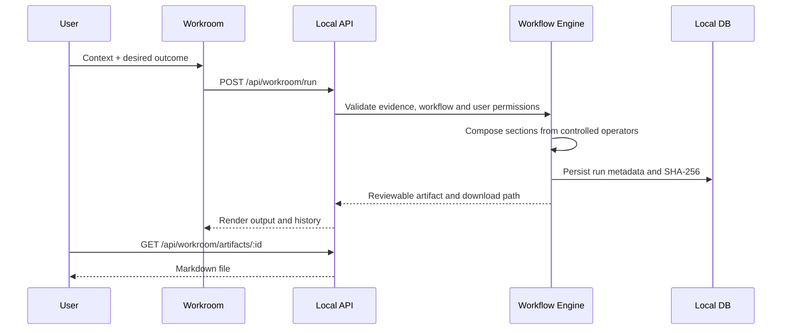

# Power Chords · Technical Architecture

## Product boundary

The original Power Chords Workroom is a local-first application with a deterministic native execution plane, integrated authoring workflows, local SQLite persistence, and a shared extension catalog. The runtime runs on Node 22+ with no dependency install required for the core server.

### Core systems

1. `src/server.mjs` — loopback HTTP interface, session cookie, origin checks, API routing, file download.
2. `src/workroom.mjs` — first-party 52-capability registry, workflow composer, evidence index, artifact generator, per-user native controls, integrity validation.
3. `src/db.mjs` — durable user-scoped registry, source and package states, audit events.
4. `src/engine.mjs` — optional source inspection, pinned instruction imports, permission-checked intent preview; no arbitrary external code execution.
5. `src/catalog.mjs` — maintained source metadata and preliminary integration mapping.
6. `public/` — coherent Workroom UI first; extension library secondary.

### Workflow execution

### What is implemented vs. what requires an adapter

The initial Workroom supports four actual executable *document-generation* workflows. The 52-item capability catalog covers a longer-term product surface and distinguishes `native_assistive` from `adapter_required`. A native assistive capability supports drafting, planning, framing or structured analysis; it does not imply production-verified external execution.

Standalone desktop tools, cloud providers, model runtimes, speech systems and agent packages require adapter-level review. No sourced code is vendored here merely because a repository appears in the extension index.

### Privacy and safety

- User-provided notes remain in local files and are not sent to a model or third-party provider by native workflows.
- All native execution is user-initiated; no automatically triggered external writes or sends.
- Audit logs record metadata, not user note contents.
- Generated files are hashed and retrieval validates ownership and integrity.
- External packages are untrusted and must be inspected and permissioned separately.
- Database and artifact encryption are NOT implemented; local machine protections still apply.

### Verification

`npm test` runs isolated package, source sync, native Workroom, user isolation, validation, and HTTP boundary tests. `npm run demo` produces a standalone sample work product without secrets or network access.

## Agent-portable instruction layer (V0.3)

The 52 functional capability specifications are maintained in `data/capability-guides.json`.
Each capability has a function-named directory with a README, standard `SKILL.md`,
structured `capability.json` manifest, and a working example request.

The document generator (`npm run capabilities:docs`) derives the packages from
that first-party manifest, and `npm run validate:capabilities` checks that they
remain aligned with the canonical Workroom capability IDs and execution status.

The first-party CLI installer (`node scripts/capabilities-cli.mjs`) supports
project-relative agent skill directories for Codex, Claude Code, Cursor,
Gemini CLI, plus `--dest` for other compatible hosts. It copies skill instructions
and metadata but never invokes external executables. No compatibility guarantee
can be made for an agent version without an actual integration test.

These portable instruction packs **do not grant external execution capability**.
When a host lacks a browser, OCR runtime, data source, model, media engine or
other required tool, the skill is limited to an honest plan or artifact draft.
Future specialized adapters must satisfy the contracts, permission boundary
and capability-specific tests before being marked executable.
